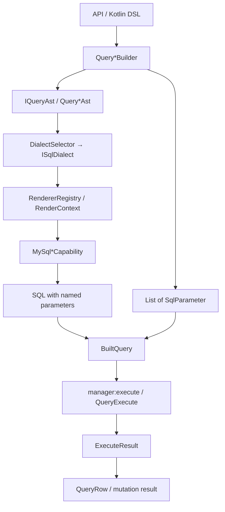
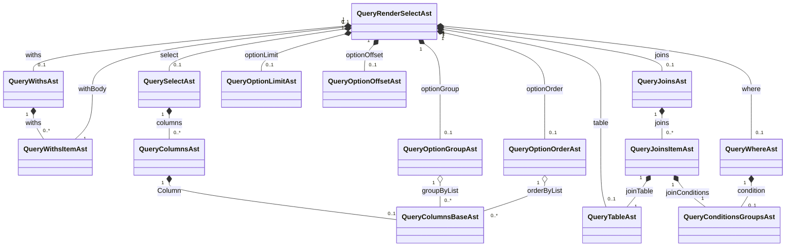
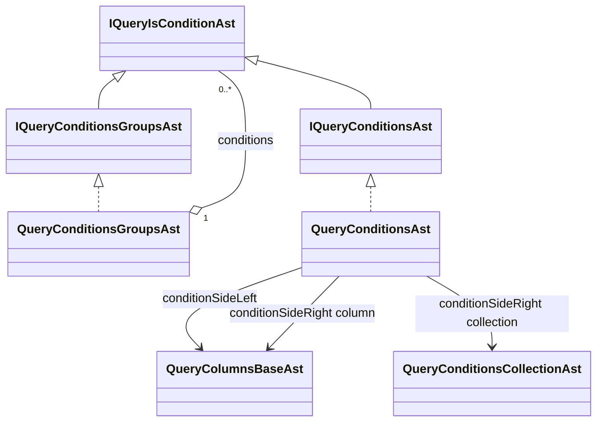
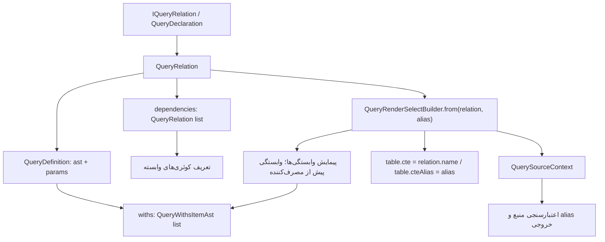

# نمودار درختی و روابط Query Builder

این سند از کد موجود در `data_base:query` در تاریخ ۲۰۲۶-۱۰-۱۰ استخراج شده است؛ تغییرات فعلی پوشهٔ کاری نیز در آن لحاظ شده‌اند. منظور از رابطه، هم ترکیب گره‌های کوئری است و هم وابستگی کوئری‌های قابل‌ترکیب به یکدیگر؛ این نمودار، ERD جدول‌های دیتابیس نیست.

## ۱. نمای ماژول‌ها و جریان ساخت کوئری

```text
data_base:query
├── ast         ساختار داده و قرارداد گره‌های کوئری
├── api         قرارداد DSL و QueryDefinition / QueryRelation
├── builder     پیاده‌سازی DSL، ساخت AST و جمع‌آوری پارامترها
├── dialect     قرارداد رندر، Registry، Context و داده‌های کمکی رندر
├── renderer    پیاده‌سازی رندر SQL برای MySQL و MariaDB
├── executor    اتصال Builder به اجرا و مصرف نتیجه
└── example     نمونه‌های استفاده، از جمله کوئری‌های نسخهٔ v3
```

پیکان‌های نمودار زیر جریان داده و فراخوانی را نشان می‌دهند، نه وابستگی مستقیم Gradle:



در `builder`، هر Builder قرارداد API متناظر خود را پیاده‌سازی می‌کند. قرارداد پایهٔ `IQueryApi<A : IQueryAst>` دو عضو `ast` و `params` دارد؛ بنابراین مقدار پارامترها در کنار AST نگهداری می‌شود. انتخاب دیالکت و تبدیل AST به SQL در مسیر `executor` انجام می‌شود. `MariaDbDialect` در وضعیت فعلی از `MySqlDialect` ارث‌بری می‌کند.

وابستگی‌های مستقیم تولیدی داخل خانوادهٔ `query`، مطابق `implementation(project(...))` در فایل‌های Gradle:

| ماژول | وابستگی مستقیم به سایر زیرماژول‌های query |
| --- | --- |
| `ast` | ندارد |
| `api` | `ast` |
| `builder` | `ast`, `api` |
| `dialect` | `ast`, `api`, `builder` |
| `renderer` | `ast`, `api`, `dialect` |
| `executor` | `ast`, `api`, `builder`, `dialect`, `renderer` |
| `example` | `ast`, `api`, `builder`, `renderer`, `executor` |

وابستگی‌های بیرونی مانند `data_base:core`، `data_base:manager:execute` و `data_base:models:eloquent` و وابستگی‌های تست در این جدول نیامده‌اند.

## ۲. درخت اصلی SELECT

در درخت‌ها `?` یعنی مقدار nullable، `[]` یعنی فهرست با صفر یا چند عضو، و `↩` یعنی ارجاع به ساختاری که جداگانه توضیح داده شده است. نام فیلدها با حروف بزرگ و کوچک کد حفظ شده‌اند. برای خوانایی، نام کلاس concrete نمایش داده شده؛ نوع بیشتر ارتباط‌ها در کد، interface متناظر `IQuery…Ast` است.

```text
QueryRenderSelectBuilder
├── params: MutableList<SqlParameter<*>>
├── modelAliasContext: ModelTableAliasContext
├── querySourceContext: QuerySourceContext
└── ast: IQueryRenderSelectAst → QueryRenderSelectAst
    ├── withs?: QueryWithsAst
    │   └── withs[]: QueryWithsItemAst
    │       ├── withName?: String
    │       └── withBody?: IQueryRenderSelectAst ↩ SELECT کامل
    ├── select?: QuerySelectAst
    │   └── columns[]: QueryColumnsAst
    │       ├── ColumnMethod?: String
    │       ├── Column?: QueryColumnsBaseAst ↩ مرجع ستون
    │       ├── ColumnAlias?: String
    │       ├── ExecutionType?: DataType
    │       └── PropertyReference?: KProperty1<*, *>
    ├── table?: QueryTableAst ↩ منبع FROM
    ├── joins?: QueryJoinsAst
    │   └── joins[]: QueryJoinsItemAst
    │       ├── joinType?: String
    │       ├── joinTable: QueryTableAst ↩ منبع JOIN
    │       └── joinConditions: QueryConditionsGroupsAst ↩ شرط ON
    ├── where?: QueryWhereAst
    │   └── condition?: QueryConditionsGroupsAst ↩ درخت شرط
    ├── optionGroup?: QueryOptionGroupAst
    │   └── groupByList[]: QueryColumnsBaseAst
    ├── optionOrder?: QueryOptionOrderAst
    │   ├── orderByList[]: QueryColumnsBaseAst
    │   └── orderType?: String
    ├── optionLimit?: QueryOptionLimitAst
    │   └── pageLimit?: Long
    └── optionOffset?: QueryOptionOffsetAst
        └── pageOffset?: Long
```

روابط اصلی SELECT در قالب Mermaid:



علامت ترکیب در نمودار، نگهداری گرهٔ فرزند در والد را نشان می‌دهد؛ تضمین مالکیت انحصاری یا کپی عمیق نیست. چند کوئری می‌توانند به گره‌های مشترک ارجاع داشته باشند. همچنین nullable بودن فیلدهای AST به معنای معتبر بودن همهٔ ترکیب‌های آن‌ها برای تولید SQL نیست.

## ۳. منبع جدول و مرجع ستون

```text
QueryTableAst
├── table?: String          نام جدول
├── tableAlias?: String     alias جدول
├── cte?: String            نام CTE
└── cteAlias?: String       alias منبع CTE

QueryColumnsBaseAst
├── tableAttribute?: String
├── tableAlias?: String
├── column?: String
├── cteAlias?: String
└── select?: String
```

`QueryTableAst` برای FROM و JOIN مشترک است. `QueryColumnsBaseAst` نیز در خروجی SELECT، دو طرف شرط، GROUP BY و ORDER BY استفاده می‌شود. APIهای مبتنی بر مدل و property، متادیتای مدل را به این ساختارها تبدیل می‌کنند؛ خود مدل به‌عنوان فرزند AST ذخیره نمی‌شود.

## ۴. درخت بازگشتی شرط‌ها

```text
QueryConditionsGroupsAst
├── isAddLogical: Boolean
├── conditionLogical?: String
└── conditions[]: IQueryIsConditionAst
    ├── QueryConditionsGroupsAst ↩ گروه تو‌در‌تو
    └── QueryConditionsAst
        ├── isAddLogical: Boolean
        ├── conditionLogical?: String
        ├── conditionSideLeft?: QueryColumnsBaseAst
        ├── conditionOperation?: String
        └── conditionSideRight: Any?
            ├── QueryColumnsBaseAst        مقایسه با ستون
            ├── String مثل ":user_id"     ارجاع به پارامتر
            └── QueryConditionsCollectionAst
                └── paramsCollection[]: Any
```

در DSL، `addGroup` و `addCondition` اعضای یک فهرست مشترک را می‌سازند. همین درخت برای WHERE و شرط JOIN استفاده می‌شود. `sideValue(name, value)` نشانگر `:name` را در AST و مقدار واقعی را در `params` می‌گذارد. `sideValueCollection` مجموعه‌ای از نام‌های پارامتر مانند `ids0` و `ids1` می‌سازد؛ نوع فهرست در AST برابر `MutableList<Any>` است، ولی Builder نام‌ها را در آن ثبت می‌کند. `conditionSideRight` از نظر قرارداد `Any?` است؛ شاخه‌های بالا مسیرهای ساخت بررسی‌شده در DSL هستند.



## ۵. رابطهٔ کوئری‌های قابل‌ترکیب و CTE

نام‌گذاری فعلی یکدست نشده است: کلاس پایهٔ اعلان `QueryDeclaration<P>` و context داخلی `QuerySourceContext` نام دارند، اما قرارداد عمومی همچنان `IQueryRelation<P>` و خروجی آن `QueryRelation` است.

```text
اعلان کوئری
├── IQueryRelation<P>
│   └── queryRelation(params: P): QueryRelation
└── QueryDeclaration<P> : IQueryRelation<P>  پایهٔ اختیاری
    └── buildQueryRelation { ... }
        └── QueryRelation → BuiltQueryComposition
            ├── name: String
            ├── definition: QueryDefinition → BuiltQueryDefinition
            │   ├── ast: IQueryRenderSelectAst
            │   └── params: List<SqlParameter<*>>
            ├── dependencies[]: QueryRelation ↩ کوئری‌های منبع
            └── declarationOwner?: KClass<*>  عضو پیاده‌سازی داخلی
```

پیاده‌سازی مستقیم `IQueryRelation<P>` نیز با extension تابع `buildQueryRelation` پشتیبانی می‌شود. `queryRelation(name) { ... }` مسیر ساخت بدون الزام به کلاس اعلان است.



رفتارهایی که در پیاده‌سازی فعلی اعمال می‌شوند:

- هر `QueryRelation` باید SELECT با حداقل یک خروجی و aliasهای غیرخالی و یکتا داشته باشد.
- هر SELECT در مسیر `from(relation)` فقط یک منبع `QueryRelation` می‌پذیرد. این محدودیت مربوط به منبع relation است؛ فهرست JOIN همچنان ساختار جداگانهٔ خود را دارد.
- `from(relation)` با منبع جدولِ از قبل تنظیم‌شده قابل‌ترکیب نیست و پس از آن نیز `table { ... }` پذیرفته نمی‌شود.
- وابستگی‌ها با هویت شیء پیمایش می‌شوند؛ چرخه و نام CTE تکراری رد می‌شوند.
- CTE وابسته پیش از کوئری مصرف‌کننده ثبت می‌شود و پارامترهای relation به ابتدای فهرست پارامترهای کوئری مصرف‌کننده افزوده می‌شوند.
- ارجاع خروجی باید به منبع فعال و یکی از aliasهای منتشرشدهٔ آن تعلق داشته باشد؛ مسیر typed، مالک اعلان را نیز بررسی می‌کند.

نمونهٔ واقعی در `example/v3`:

```text
UserPageQueryV3 / user_page_query_v3
└── from(UserStatsQueryV3 / user_stats_query_v3)
    └── UserModelV3

ترتیب CTE هنگام مصرف UserPageQueryV3 با from(...):
WITH user_stats_query_v3 AS (...), user_page_query_v3 AS (...)
SELECT ... FROM user_page_query_v3
```

پس ساختار AST در سطح اجزای کوئری درختی است، اما قرارداد `dependencies` یک گراف وابستگی را مدل می‌کند؛ Builder آن را برای ساخت CTEها مرتب می‌کند. محدودیت یک منبع relation در Builder فعلی، زنجیره‌سازی را ممکن می‌کند و به معنی پشتیبانی DSL از چند منبع relation در یک SELECT نیست.

## ۶. درخت INSERT، UPDATE و DELETE

```text
QueryRenderInsertBuilder
├── params: MutableList<SqlParameter<*>>
└── ast: QueryRenderInsertAst
    ├── table?: QueryTableAst
    └── columns[]: QueryColumnInsertAst
        ├── columnName?: String
        └── columnTag?: String

QueryRenderUpdateBuilder
├── params: MutableList<SqlParameter<*>>
└── ast: QueryRenderUpdateAst
    ├── table?: QueryTableAst
    ├── columns[]: QueryColumnUpdateAst
    │   ├── columnAlias?: String
    │   ├── columnName?: String
    │   └── columnTag?: String
    └── where?: QueryWhereAst ↩ درخت شرط مشترک

QueryRenderDeleteBuilder
├── params: MutableList<SqlParameter<*>>
└── ast: QueryRenderDeleteAst
    ├── targets[]: String
    ├── table?: QueryTableAst
    └── where?: QueryWhereAst ↩ درخت شرط مشترک
```

مقدارهای INSERT و UPDATE در `params` نگهداری می‌شوند و `columnTag` برای اتصال ستون به پارامتر استفاده می‌شود. در AST این سه عملیات، فرزند مستقیمی برای `joins`، `withs` یا گزینه‌های صفحه‌بندی تعریف نشده است.

## ۷. رابطهٔ Builder، رندر و نتیجه

```text
QueryBuilderExecutor : IQueryBuilderExecutor
└── queryBuilder { ... } → QueryBuilderSelection
    ├── querySelect / select → QueryConsumer
    │   ├── sql()     → BuiltQuery
    │   ├── first()   → ExecuteResult<QueryRow>
    │   └── execute() → ExecuteResult<List<QueryRow>>
    ├── queryInsert / insert → InsertQueryConsumer
    │   ├── sql()     → BuiltQuery
    │   └── execute() → ExecuteResult<Long>
    ├── queryUpdate / update → UpdateQueryConsumer
    │   ├── sql()     → BuiltQuery
    │   └── execute() → ExecuteResult<Int>
    └── queryDelete / delete → DeleteQueryConsumer
        ├── sql()     → BuiltQuery
        └── execute() → ExecuteResult<Int>
```

علاوه بر این ورودی، overloadهای `queryBuilder(query)` یک Builder ساخته‌شده را به consumer متناظر متصل می‌کنند. استخراج `QueryRow` در مسیر `first/get` نیازمند alias خروجی و `ExecutionType` برای هر ستون است. `DataType` فعلاً سه مقدار `LONG`، `INT` و `STRING` دارد. این الزامِ مصرف نتیجه از الزام alias در تعریف relation جداست.

## ۸. منابع کد برای بازبینی

همهٔ مسیرهای زیر نسبت به این فایل هستند:

| موضوع | منبع |
| --- | --- |
| ثبت زیرماژول‌ها | [settings.gradle.kts](../settings.gradle.kts) |
| قرارداد پایهٔ Builder | [IQueryApi.kt](../data_base/query/api/src/main/kotlin/interfaces/api/IQueryApi.kt) |
| ریشهٔ SELECT | [QueryRenderSelectAst.kt](../data_base/query/ast/src/main/kotlin/schema/select_schema/query_render_select/QueryRenderSelectAst.kt) |
| گره‌های AST چهار عملیات | [schema](../data_base/query/ast/src/main/kotlin/schema) |
| قرارداد شرط بازگشتی | [IQueryIsConditionAst.kt](../data_base/query/ast/src/main/kotlin/interfaces/select_interface/conditions/IQueryIsConditionAst.kt) |
| ساخت SELECT، CTE و مرتب‌سازی وابستگی‌ها | [QueryRenderSelectBuilder.kt](../data_base/query/builder/src/main/kotlin/ast/select_builder/query_render_select/QueryRenderSelectBuilder.kt) |
| ساخت مقدار و پارامتر شرط | [QueryConditionsBuilder.kt](../data_base/query/builder/src/main/kotlin/ast/select_builder/conditions_item/QueryConditionsBuilder.kt) |
| قراردادهای کوئری قابل‌ترکیب | [relations](../data_base/query/api/src/main/kotlin/interfaces/relations) |
| ساخت relation و اعتبارسنجی خروجی | [QueryRelationBuilder.kt](../data_base/query/builder/src/main/kotlin/relations/QueryRelationBuilder.kt) |
| پایهٔ اختیاری اعلان | [QueryDeclaration.kt](../data_base/query/builder/src/main/kotlin/relations/QueryDeclaration.kt) |
| منبع فعال و خروجی typed | [QuerySourceContext.kt](../data_base/query/builder/src/main/kotlin/ast/select_builder/QuerySourceContext.kt) |
| نمونهٔ زنجیرهٔ کوئری‌ها | [UserPageQueryV3.kt](../data_base/query/example/src/main/kotlin/v3/queries/relations/UserPageQueryV3.kt) |
| انتخاب دیالکت | [DialectSelector.kt](../data_base/query/renderer/src/main/kotlin/manager/DialectSelector.kt) |
| ترتیب رندر اجزای SELECT | [MySqlQueryCapability.kt](../data_base/query/renderer/src/main/kotlin/nodes/select_nodes/query/MySqlQueryCapability.kt) |
| ورودی و مصرف نتیجه | [IQueryBuilderExecutor.kt](../data_base/query/executor/src/main/kotlin/interfaces/IQueryBuilderExecutor.kt)، [QueryBuilderSelection.kt](../data_base/query/executor/src/main/kotlin/result/QueryBuilderSelection.kt) |

این استخراج با خواندن قراردادها، پیاده‌سازی Builderها، ASTها، رندر و نمونه‌های کد انجام شده است؛ اجرای SQL یا اتصال به دیتابیس جزو این بررسی نبوده است.
