# Plan 14.0 — معماری هویت پارامتر و اجرای QueryBuilder

## وضعیت

**وضعیت طراحی:** آمادهٔ صدور مجوز پیاده‌سازی
**Implementation Authorization:** صادر نشده  
**دامنهٔ این سند:** بررسی Repository، تصمیم‌های معماری و معیارهای پذیرش؛ بدون تغییر کد.

Plan 14.0 مبنای مستقل طراحی این کار است. Planهای 13 و 13.1 فقط سابقه و شواهد تغییرات قبلی‌اند و نباید به‌صورت مرحله‌ای ادامه داده شوند. این تصمیم مجوز حذف یا بازنویسی فایل‌های آن Planها یا تغییرات موجود working tree نیست.

## 1. هدف و مسئله

مسیر اجرای فعلی پارامترها را با نام placeholder در SQL تطبیق می‌دهد. در نتیجه، دو تعریف مستقل با نام منطقی یکسان نمی‌توانند مقدارهای متفاوت داشته باشند، حتی اگر در AST و Scopeهای مستقل قرار گرفته باشند. هدف این Plan، نگهداری تعریف پارامتر و هویت آن در ساختار Query، ثبت رخدادها بر اساس ترتیب SQL و Bind کردن JDBC بر اساس همان رخدادهاست.

نمونهٔ الزام‌آور برای مسیر نهایی:

- CTE یا Declaration داخلی: `shared_value = 11`
- Declaration والد: `shared_value = 22`
- Query مصرف‌کننده: `shared_value = 33`

هر سه مقدار باید مستقل بمانند؛ نام `shared_value` فقط نام منطقی/قابل‌مشاهده است و هویت binding را تعیین نمی‌کند.

## 2. شواهد Repository و محدودیت بررسی

این خلاصه بر source، Gradle و تست‌های موجود در working tree مورخ **2026-10-13** استوار است. در این مرحله Build و Test اجرا نشده‌اند. وضعیت Git هنگام تهیهٔ Plan روی شاخهٔ `main` نسبت به `origin/main` شامل **۱۶ فایل tracked تغییرکرده، ۶ فایل untracked و هیچ تغییر staged نبود**. منشأ هر تغییر از روی status به‌تنهایی قابل اثبات نیست؛ هیچ‌یک صرفاً به دلیل ارتباط ظاهری با Plan 13.1 قابل حذف یا نسبت‌دادن قطعی نیست.

این شمارش، snapshot تاریخیِ ممیزی اولیه است. در شروع بازبینی حاضر، `git status --short --branch` خروجی `## main...origin/main [ahead 1]` و working tree بدون تغییر نشان داد. در بازبینی حاضر Build/Test اجرا نشده و هیچ تغییری خارج از دو سند Plan مجاز نیست.

### 2.1 ماژول‌ها و وابستگی‌های مستقیم

گراف زیر از `settings.gradle.kts` و `build.gradle.kts`های فعلی استخراج شده است. پیکان از مصرف‌کننده به وابستگی است.

| ماژول | وابستگی مستقیم مرتبط | مسئولیت مرتبط با پارامتر |
|---|---|---|
| `data_base:core` | ندارد | `SqlParameter`, `BuiltQuery`, تشخیص نوع SQL و `bind(PreparedStatement, index)` |
| `data_base:query:ast` | `core` | قراردادها و nodeهای AST؛ اکنون چند فیلد مقدار را به‌صورت `Any?`, `MutableList<Any>` یا نام/tag متنی نگه می‌دارند |
| `data_base:query:api` | `core`, `query:ast` | APIهای Builder و `IQueryApi.params` |
| `data_base:query:builder` | `core`, `query:ast`, `query:api` | ایجاد پارامترها، ثبت آن‌ها در AST و فهرست‌های Builder |
| `data_base:query:dialect` | `core`, `query:ast`, `query:api`, `query:builder` | `ISqlDialect`, render context/registry و dispatcher پایه |
| `data_base:query:renderer` | `core`, `query:api`, `query:ast`, `query:dialect` | تولید SQL clause به clause؛ شامل MySQL و MariaDB |
| `data_base:query:executor` | `tools`, `core`, `query:ast`, `query:builder`, `query:api`, `query:dialect`, `query:renderer`, `manager:execute` | اتصال Builder، Renderer و اجرای Query |
| `data_base:query:example` | `tools`, `core`, `models:eloquent`, `manager:execute`, `query:api`, `query:ast`, `query:builder`, `query:renderer`, `query:executor` | نمونه‌های DSL و regressionهای مثال |
| `data_base:manager:execute` | `manager:connection`, `core` | تبدیل SQL اجرایی به JDBC statement و Bind positional؛ نگهداری قرارداد نام‌محور legacy |
| `data_base:migration:builder` | `core`, `migration:params`, `migration:ast`, `migration:api` | Builderهای Migration و فهرست پارامترهای legacy |
| `data_base:migration:executor` | ماژول‌های Migration، چند ماژول Query و `manager:execute` | اجرای Migration از مسیر جداگانهٔ `BuiltQuery`/`IQueryExecute` |

`settings.gradle.kts` ماژول `data_base:query:meta_data` را ثبت نمی‌کند. `plans/meta_data/vision.md` یک سند چشم‌انداز است و وجود آن به معنی وجود ماژول اجرایی نیست.

وابستگی `query:dialect → query:builder` در Gradle وجود دارد؛ جست‌وجوی source در این ممیزی مصرف مستقیم آن را روشن نکرد. در Plan اجرایی حذف یا جابه‌جایی این edge مجاز نیست مگر اینکه مصرف واقعی و امکان کامپایل جداگانه بررسی شود.

### 2.2 مسیر فعلی پارامتر

```text
sideValue(name, value) / addParam(value) / insert-column / update-column
       │
       ├── SqlParameter.of(name, value)  (یا nullOf(name, sqlType))
       ├── AST: متن نام‌دار یا SqlParameter reference در نسخهٔ جاری working tree
       └── IQueryApi.params: MutableList<SqlParameter<*>>
                 │
                 ├── dialect.render(ast) -> SQL نام‌دار مانند :shared_value
                 └── QueryBuilderExecutor.executeOut -> BuiltQuery(sql, params)
                          │
                          └── BuiltQuery.getListParamNames()
                              -> IQueryExecute.readyParamsInQuery()
                              -> تطبیق بر اساس name
                              -> SqlParameter.bind(ps, index)
```

شواهد و مسیرها:

- `data_base/core/src/main/kotlin/query/reader/SqlParamData.kt`: `SqlParameter<T>` یک `data class` با `name`, `value`, `sqlType` است. `of` نوع SQL را resolve می‌کند، `nullOf` نوع null را صریح می‌گیرد و `bind` از `setNull` یا `setObject` استفاده می‌کند. فیلد `id` وجود ندارد.
- `data_base/core/src/main/kotlin/query/reader/BuiltQuery.kt`: `getListParamNames()` placeholderهای `:name` را از SQL به ترتیب متنی استخراج می‌کند، پارامترهای هم‌نام را از نظر value و sqlType اعتبارسنجی می‌کند و پارامتر اضافه/گمشده را رد می‌کند؛ `getReadyQuery()` placeholderها را به `?` تبدیل می‌کند.
- `data_base/query/api/src/main/kotlin/interfaces/api/IQueryApi.kt`: قرارداد عمومی `ast` و `params: MutableList<SqlParameter<*>>` را ارائه می‌کند.
- `data_base/query/builder/src/main/kotlin/ast/select_builder/conditions_item/QueryConditionsBuilder.kt`: `sideValue(name, value)` پارامتر scalar می‌سازد و به AST و `params` می‌دهد.
- `data_base/query/builder/src/main/kotlin/ast/select_builder/conditions_item_collection/QueryConditionsCollectionBuilder.kt`: collection نام‌های `${prefix}${index}` را به AST و فهرست Builder می‌دهد.
- `data_base/query/builder/src/main/kotlin/ast/insert_builder/column_insert/QueryColumnInsertBuilder.kt` و `data_base/query/builder/src/main/kotlin/ast/update_builder/column_update/QueryColumnUpdateBuilder.kt`: پارامترها در فهرست نگه‌داری می‌شوند؛ AST فعلی `columnTag` متنی دارد.
- `data_base/query/executor/src/main/kotlin/interfaces/IQueryBuilderExecutor.kt`: `executeOut` با `dialect.render(ast)` و `queryBuilder.params` یک `BuiltQuery` می‌سازد؛ `paramsMap` برای callback با `associate { name to value }` تولید می‌شود و برای نام‌های تکراری lossy است.
- `data_base/manager/execute/src/main/kotlin/interfaces/IQueryExecute.kt`: `execute(BuiltQuery)` ابتدا query و نام occurrenceها را آماده و mismatchها را پیش از بازکردن connection اعتبارسنجی می‌کند؛ `readyParamsInQuery` پارامترها را با نام resolve می‌کند.
- `data_base/manager/execute/src/main/kotlin/manager/QueryExecute.kt`: هر occurrence نامی به index JDBC مربوطه Bind می‌شود. این مسیر ترتیب occurrenceهای SQL را حفظ می‌کند، اما دو تعریف هم‌نام با مقادیر متفاوت را نمی‌تواند resolve کند.

### 2.3 AST، Builder و ترتیب SQL

- `IQueryRenderSelectAst` در `data_base/query/ast/src/main/kotlin/interfaces/select_interface/query_render_select/IQueryRenderSelectAst.kt` ساختار `withs`, `select`, `table`, `joins`, `where`, `group`, `order`, `limit`, `offset` را نگه می‌دارد.
- `IQueryConditionsAst.conditionSideRight` در `.../conditions_item/IQueryConditionsAst.kt` از نوع `Any?` است؛ `IQueryConditionsCollectionAst.paramsCollection` در `.../conditions_item_collection/IQueryConditionsCollectionAst.kt` از نوع `MutableList<Any>` است.
- `IQueryColumnInsertAst` و `IQueryColumnUpdateAst` در مسیرهای `interfaces/insert_interface/column_insert/` و `interfaces/update_interface/column_update/` فقط `columnTag: String?` را برای placeholder دارند.
- `QueryRenderSelectBuilder` clauseها را در فیلدهای مستقل AST ثبت می‌کند؛ بنابراین ترتیب فراخوانی `where`, `from`, `joins` به‌تنهایی ترتیب SQL را تعیین نمی‌کند.
- `MySqlQueryCapability.render` ترتیب متنی render را تعیین می‌کند: `WITH`, `SELECT`, `FROM`, `JOIN`, `WHERE`, `GROUP`, `ORDER`, `LIMIT`, `OFFSET`.
- `MySqlQueryConditionCapability` و `MySqlQueryConditionCollectionCapability` پارامترهای condition را به SQL نام‌دار تبدیل می‌کنند. در working tree جاری، occurrence collector در صورت فعال بودن از همین render مسیر ثبت می‌شود و scalar شرط نامعتبر پیش از ثبت rollback می‌شود.
- `MySqlQueryTableCapability` بازگشتی به `derivedQuery` دارد؛ CTEهای تو‌در‌تو و queryهای مشتق‌شده بخشی از render بازگشتی‌اند.

### 2.4 Dialectها و تست‌ها

- `data_base/query/renderer/src/main/kotlin/dialects/MySqlDialect.kt` ثبت rendererهای SELECT و mutation را انجام می‌دهد. `MariaDbDialect` از `MySqlDialect` ارث می‌برد. `DialectQuery` فعلاً MySQL و MariaDB را معرفی می‌کند؛ SQLite comment شده است.
- قرارداد `ISqlDialect.render(ast): String?` در `query:dialect` فقط رشته برمی‌گرداند. `BaseSqlDialect.renderWithBindings` که اکنون در working tree دیده می‌شود، خروجی `Pair<String?, List<Any>>` دارد و در `ISqlDialect` نیست؛ مصرف‌کننده‌ای که فقط `ISqlDialect` می‌بیند این قابلیت را تضمین‌شده ندارد.
- تست‌های موجود: `data_base/core/src/test/kotlin/query/reader/BuiltQueryTest.kt`, `data_base/manager/execute/src/test/kotlin/manager/QueryExecuteContractTest.kt`, `data_base/query/builder/src/test/kotlin/ast/select_builder/InlineCteParameterBindingTest.kt`, `QueryRelationContractTest.kt`, `QueryDeclarationTest.kt`, `QueryMetadataResolutionTest.kt`, `TypedRelationPropertyTest.kt`, `QueryRelationMySqlIntegrationTest.kt` و `data_base/query/executor/src/test/kotlin/manager/QueryConsumerTest.kt`, `SmartQueryResultTest.kt`.
- تست‌های `ParameterBindingScopeTest` و `ParameterIdentityPhaseOneTest` نیز در working tree حاضرند، اما untracked بودن آن‌ها و تغییرات دیگر به‌تنهایی منشأ یا مالک تغییر را ثابت نمی‌کند. در Plan اجرایی این تست‌ها باید بازبینی و در صورت سازگاری حفظ/تکمیل شوند، نه حذف خودکار.

## 3. تصمیم‌های معماری هدف

### 3.1 تعریف و هویت

1. `SqlParameter<T>` در `data_base/core/src/main/kotlin/query/reader/SqlParamData.kt` بدون تغییر شکل عمومی باقی می‌ماند: constructor سه‌فیلدی فعلی، `of`, `nullOf`, `data class`, `copy`, component functions، equality و `bind` حفظ می‌شوند. فیلد شناسه، allocator و state سراسری اضافه نمی‌شود.
2. در مسیر identity-aware، هویت فنی یک binding برابر هویت مرجعی همان نمونهٔ `SqlParameter` است. تمام map/setهای هویت‌محور از `===` یا `IdentityHashMap` استفاده می‌کنند؛ `name`, `value`, `sqlType` و `equals()` هویت این مسیر را تعیین نمی‌کنند.
3. یک reference واحد که چند بار به AST وصل شده، یک definition با چند occurrence است؛ برای هر occurrence یک JDBC index جدا صادر می‌شود. دو reference مستقل با نام، مقدار و نوع SQL یکسان نیز دو definition مستقل‌اند. دو reference مستقل با نام یکسان و مقدار یا نوع متفاوت هم در مسیر identity-aware مستقل می‌مانند.
4. `copy()` یک reference جدید می‌سازد؛ با وجود برابری داده‌ای، در مسیر identity-aware مستقل است. `nullOf(name, sqlType)` مقدار null و `sqlType` همان reference را تعیین می‌کند؛ دو reference null با `sqlType`های متفاوت در مسیر identity-aware مستقل‌اند.
5. برای حفظ رفتار فعلی APIهای مقدارمحور، فراخوانی‌های `sideValue(name, value)` و `addParam(value)` که از یک نمونهٔ مشترک `ParameterBindingScope` استفاده می‌کنند، همچنان از `ParameterBindingScope.canonical()` می‌گذرند: پارامتر هم‌نام با `value ==` و `sqlType` برابر به همان reference قبلی canonical می‌شود. هم‌نام با مقدار یا `sqlType` متفاوت در همان scope همان‌جا خطا می‌دهد. این reuse محدود به همان نمونهٔ scope است؛ scopeهای مستقل Declarationها با هم canonical نمی‌شوند.
6. APIهای handleمحور پیشنهادی هویت مرجعی را عیناً حفظ می‌کنند و canonicalization داده‌ای انجام نمی‌دهند. بنابراین دو handle هم‌نام—even اگر `equals()` برابر باشند—مستقل می‌مانند؛ تکرار همان handle عمداً reuse است. اگر یک handle در چند محل رندر شود، هر محل occurrence جدا دارد.
7. قرارداد Legacy جداست: `BuiltQuery(sql, params)` و `IQueryExecute.readyParamsInQuery()` همچنان بر اساس نام resolve می‌کنند؛ duplicate name با مقدار و نوع برابر پذیرفته و با مقدار یا نوع متعارض رد می‌شود. این رفتار نباید به مسیر identity-aware تعمیم داده یا در آن تقلید شود.

### 3.2 نقطهٔ ایجاد و API مصرف‌کننده

- امضای value-based موجود `sideValue(name, value)`، `addParam(value)` و APIهای فعلی INSERT/UPDATE حفظ می‌شوند. در SELECT، `QueryConditionsBuilder` و `QueryConditionsCollectionBuilder` از `ParameterBindingScope.canonical()` استفاده می‌کنند؛ scope از `QueryRenderSelectBuilder` به Builderهای clause، JOIN و nested table همان Query منتقل می‌شود. Declaration مستقلی که با Builder مستقل ساخته شود scope جدا دارد. بنابراین «همان scope» دقیقاً همان instance از `ParameterBindingScope` است، نه هر عبارت تو‌در‌تو به‌طور کلی.
- برای reuse عمدی یک handle، فقط extensionهای عمومی محدود و بدون افزودن abstract member به interfaceها پیشنهاد می‌شوند: `IQueryConditionsApi.sideValue(parameter: SqlParameter<*>)` و `IQueryConditionsCollectionApi.addParameter(parameter: SqlParameter<*>)`. این extensionها در ماژول `query:api` مستقیماً همان reference را در AST و `params` compatibility list می‌گذارند و از canonicalization عبور نمی‌کنند. `addParameter` یک آیتم اسکالر و یک placeholder در collection می‌افزاید؛ مجموعه‌ای از تعریف‌ها نمی‌پذیرد. هر بار فراخوانی با همان handle یک occurrence دیگر از همان binding است.
- `ParameterBindingScope` فقط فراخوانی‌های value-based خودش را canonical می‌کند و از extensionهای handleمحور خبر ندارد. پس استفاده از handle و value API با name یکسان دو مسیر است: identity route آن‌ها را دو binding می‌داند؛ اگر مقادیرشان متعارض باشد Legacy `BuiltQuery` همچنان conflict می‌دهد. این تفاوت باید با تست صریح ثبت شود.
- برای INSERT/UPDATE در این Plan API handleمحور جدیدی اضافه نمی‌شود: هر فراخوانی موجود `column(..., value)` همچنان یک `SqlParameter` تازه می‌سازد و AST typed field همان reference را می‌گیرد. نیاز به reuse عمداً مشترک بین ستون‌های mutation باید با شواهد مصرف‌کننده جداگانه ثابت شود.
- فایل‌های extension پیشنهادی: `data_base/query/api/src/main/kotlin/interfaces/api/select_api/conditions_item/QueryParameterExtensions.kt` و `data_base/query/api/src/main/kotlin/interfaces/api/select_api/conditions_item_collection/QueryParameterExtensions.kt` (نام فایل‌ها تا مرحلهٔ پیاده‌سازی قابل‌تنظیم است؛ package و receiverهای API قطعی‌اند). Interfaceهای عمومی فعلی تغییر نمی‌کنند و implementerهای آن‌ها متد جدیدی لازم ندارند؛ call siteهای استفاده‌کننده باید extension را import کنند.
- افزودن extensionها به bytecode API است، اما signatureهای interface قدیمی و `SqlParameter` عوض نمی‌شوند. Binary compatibility کلی تضمین نمی‌شود: Repository artifact/versioning baseline یا فهرست consumer بیرونی ندارد. پیش از انتشار، JVM signature diff و سیاست نسخه‌بندی باید جداگانه بررسی شود.

### 3.3 AST و منبع حقیقت

- هر مقدار پارامتری‌شده باید یک ارجاع مستقیم و قابل‌ردیابی به همان نمونهٔ تعریف در AST داشته باشد؛ ساخت هویت از placeholder، string name یا مقدار ممنوع است.
- scalar condition در `conditionSideRight` همان `SqlParameter` reference را نگه می‌دارد؛ فیلد `Any?` فعلی می‌ماند تا column/expression و compatibility باقی بمانند. در identity-aware path، فقط انواع معلوم و پشتیبانی‌شده پذیرفته می‌شوند.
- `paramsCollection` در AST فعلی `MutableList<Any>` است. در identity-aware path تمام آیتم‌های collection باید `SqlParameter` باشند؛ قرارداد AST در فاز AST به نوع‌دار تغییر می‌کند. مقادیر خامی که renderer فعلی با `toString()` به نام placeholder تبدیل می‌کند فقط legacy representation هستند؛ ترکیب آن‌ها با referenceهای identity-aware خطاست.
- INSERT و UPDATE AST فیلد typed `SqlParameter<*>?` می‌گیرند و Builder مقدار موجود را هم در این فیلد و هم در `params` compatibility list ثبت می‌کند. `columnTag` فقط برای SQL نام‌دار و مسیر قدیمی باقی می‌ماند؛ در identity-aware mode نبود typed reference در یک ستون دارای `columnTag` باعث تشخیص mixed representation و خطا می‌شود.
- Visitor تمام nodeهای فعلی را صریح پیمایش می‌کند: SELECT/`WITH`/derived query/table/select columns/JOIN/conditions/collection/options، و rootهای INSERT/UPDATE/DELETE و nodeهای table/column/WHERE آن‌ها. `IQueryAst` sealed نیست؛ هر node ناشناخته‌ای که visitor به آن برسد با خطای `unsupported AST node` رد می‌شود، نه اینکه با no-op نادیده گرفته شود. با اضافه‌شدن هر AST node جدید باید visitor و تست ماتریس پوشش همان تغییر به‌روزرسانی شوند.

پوشش پایهٔ Visitor بر قراردادهای فعلی `data_base/query/ast/src/main/kotlin/interfaces/` استوار است:

| خانواده | Nodeها و edgeهای پیمایش‌شونده | اطلاعات پارامتری فعلی/هدف |
|---|---|---|
| SELECT root | `IQueryRenderSelectAst` → `IQueryWithsAst`, `IQuerySelectAst`, `IQueryTableAst`, `IQueryJoinsAst`, `IQueryWhereAst`, optionها | recursively وارد `WITH`, select/table/JOIN/WHERE؛ option nodeهای فعلی leaf هستند |
| WITH و derived | `IQueryWithsAst` → `IQueryWithsItemAst.withBody`; `IQueryTableAst.derivedQuery` | پیمایش CTE body و source nested |
| SELECT outputs | `IQuerySelectAst.columns` → `IQueryColumnsAst.Column` → `IQueryColumnsBaseAst` | nodeهای فعلی پارامتر ندارند؛ unknown AST extension باز هم fail-fast |
| JOIN و شرط‌ها | `IQueryJoinsAst.joins` → `IQueryJoinsItemAst.joinTable/joinConditions`; `IQueryWhereAst.condition`; `IQueryConditionsGroupsAst.conditions`; `IQueryConditionsAst.conditionSideRight`; `IQueryConditionsCollectionAst.paramsCollection` | scalar `SqlParameter`; هر collection item typed `SqlParameter` در identity mode |
| INSERT | `IQueryRenderInsertAst.table/columns` → `IQueryColumnInsertAst` | typed parameter field هدف؛ `columnTag` منبع Legacy |
| UPDATE | `IQueryRenderUpdateAst.table/columns/where` → `IQueryColumnUpdateAst` و شروط WHERE | typed column refs و typed WHERE refs؛ `columnTag` منبع Legacy |
| DELETE | `IQueryRenderDeleteAst.table/where` → شرط‌ها | WHERE scalar/collection refs |
| option و leafها | `IQueryOptionGroupAst`, `IQueryOptionOrderAst`, `IQueryOptionLimitAst`, `IQueryOptionOffsetAst`, column/table leaves | در نسخهٔ فعلی فیلد پارامتری ندارند؛ صریحاً به‌عنوان leafهای شناخته‌شده فهرست می‌شوند |

اگر `IQueryIsConditionAst` یا هر interface فرعی در runtime پیاده‌سازی ناشناخته‌ای باشد، visitor اجازهٔ عبور بی‌صدا نمی‌دهد. هر توسعهٔ AST باید هم branch پیمایش و هم تست coverage را در همان change اضافه کند.
- SELECT/CTE/derived query/Join/Where/collection/`WITH` recursive childها همان referenceها را حفظ می‌کنند؛ کپی AST مجاز است فقط اگر ارجاع را به همان `SqlParameter`ها وصل نگه دارد.
- `IQueryApi.params` و flat params Builder تا پایان مهاجرت حفظ می‌شود، اما مسیر جدید آن را منبع حقیقت binding نمی‌داند. در parallel phase این list فقط compatibility projection/legacy path و منبع مقایسه برای regression است.
- AST تنها محل نگهداری definitionهاست و metadata registry موازی برای Builder ایجاد نمی‌شود. Extractor definitionهای قابل‌دسترسی را با هویت مرجعی جمع می‌کند. Rendered occurrence باید به همان AST reference تعلق داشته باشد؛ occurrence خارج از AST رد می‌شود.
- Definition موجود در AST ولی بدون occurrence نهایی به binding منتقل نمی‌شود و به‌تنهایی خطا نیست. این حالت برای condition اختیاری/نامعتبر که Renderer عمداً از SQL حذف می‌کند معتبر است. بنابراین validation در مسیر جدید subset را کنترل می‌کند (هر occurrence باید definition معتبر داشته باشد)، نه اینکه equality تعداد تمام AST definitionها با occurrenceها را تحمیل کند. پارامتر اضافه در مسیر legacy `BuiltQuery` همچنان خطاست.

### 3.4 ماژول `query:meta_data`

**تصمیم: ایجاد ماژول مستقل `data_base:query:meta_data` در این Plan حفظ می‌شود**؛ مسئولیت آن استخراج definitionهای پارامتر و طبقه‌بندی representation از Query AST است، نه metadata عمومی Model/column.

دلیل: AST در `query:ast` نگهداری می‌شود و extraction/classification باید بدون dependency به Builder، Dialect، Renderer، Executor یا JDBC قابل‌آزمون باشد. وجود یک مصرف‌کنندهٔ اولیه به‌تنهایی دلیل کافی برای حذف مرز نیست؛ ماژول کوچک می‌ماند و فقط AST parameter metadata را می‌شناسد. ماژول نباید برای انتقال `QueryBuilderMetadata` یا reflection مربوط به Model استفاده شود.

قرارداد موردنظر:

```text
QueryParameterMetadataExtractor.inspect(ast: IQueryAst)
    -> QueryParameterMetadata

QueryParameterMetadata:
    representation: IdentityAware | LegacyOnly | MixedOrUnsupported
    containsDefinition(parameter: SqlParameter<*>): Boolean
    validateOccurrences(occurrences: List<SqlParameter<*>>)
```

Visitor با type dispatch صریح روی nodeهای فعلی کار می‌کند، نه reflection. `IdentityAware` یعنی تمام جایگاه‌های پارامتردار درخت referenceهای `SqlParameter` دارند؛ `LegacyOnly` یعنی هیچ reference identity ندارد و پارامترها در صورت وجود فقط از قراردادهای قدیمی مانند `columnTag`/مقادیر خام collection قابل‌نمایش‌اند؛ درختی که هم reference identity و هم منبع پارامتر legacy دارد `MixedOrUnsupported` است و رد می‌شود. در INSERT/UPDATE، اگر typed field همان column مقدار داشته باشد، `columnTag` متناظر فقط mirror سازگاری است و منبع پارامتر دوم محسوب نمی‌شود؛ `columnTag` تنها وقتی typed field تهی است Legacy slot است. درخت بدون پارامتر هم `LegacyOnly` می‌ماند تا مسیر فعلی حفظ شود.

Extractor فقط identity definitions و حالت representation را از AST می‌گیرد؛ ترتیب bind را تعیین نمی‌کند. `validateOccurrences` تضمین می‌کند هر occurrence با `===` در definition set وجود دارد؛ definitionهای بی‌استفاده مجازند و از bind نهایی حذف می‌شوند. هیچ هویتی از `params`, SQL، نام، مقدار یا reflection استخراج نمی‌شود. هر `IQueryAst` ناشناخته در traversal خطا می‌دهد تا توسعهٔ AST بی‌صدا metadata را ناقص نگذارد.

وابستگی‌ها:

```text
data_base:query:meta_data -> data_base:core
data_base:query:meta_data -> data_base:query:ast
data_base:query:executor -> data_base:query:meta_data
```

`query:meta_data` به `query:api`, `query:builder`, `query:dialect`, `query:renderer`, `query:executor`, `manager:execute` یا Migration وابسته نمی‌شود. `manager:execute` نیز به `query:meta_data` وابسته نخواهد شد.

#### Vision و مرزبندی مسئولیت

این ماژول یک **بازرس ساختاری Query AST برای قرارداد binding پارامترها** است. تعریف‌های پارامتر را از nodeهای AST استخراج می‌کند، هویت مرجعی و تکرار definitionها را تفسیر می‌کند، نوع representation را طبقه‌بندی می‌کند و پس از رندر، occurrenceهای اعلام‌شده را با definitionهای AST اعتبارسنجی می‌کند. این ماژول نه registry سراسری است و نه مالک چرخهٔ اجرای Query.

| مسئولیت | مالک پیشنهادی | مرز دقیق |
|---|---|---|
| ساخت و نگهداری reference پارامتر در nodeهای Query | `query:builder` و `query:ast` | Builder همان `SqlParameter` را به AST می‌دهد؛ AST آن را نگه می‌دارد. `meta_data` نه پارامتر می‌سازد، نه canonicalize می‌کند و نه scope تخصیص می‌دهد. |
| استخراج definitionها و تعیین `IdentityAware`/`LegacyOnly`/`MixedOrUnsupported` | `query:meta_data` | پیمایش فقط از روی AST و با هویت مرجعی؛ نه از روی `IQueryApi.params`، نام، مقدار، SQL یا reflection. |
| ثبت occurrence و ترتیب placeholderهای واقعاً رندرشده | `query:renderer` همراه با render context/result در `query:dialect` | هر emission پارامتر هم‌زمان occurrence را ثبت می‌کند. AST traversal به‌تنهایی نمی‌تواند شرط حذف‌شده یا شاخه‌ای را که SQL تولید نکرده تشخیص دهد، پس meta_data ترتیب bind را تعیین نمی‌کند. |
| بررسی اینکه occurrenceهای Renderer به definitionهای AST تعلق دارند | `QueryParameterMetadata.validateOccurrences(...)` در `query:meta_data`؛ فراخوانی از `query:executor` | هر occurrence باید با `===` در definitionهای همان AST باشد؛ تکرار occurrence همان reference مجاز و definition بلااستفاده مجاز است. اعتبار تعداد و ترتیب placeholderهای متنی را Renderer فراهم می‌کند. |
| انتخاب مسیر و ساخت انتقال JDBC | `query:executor`, سپس `manager:execute` | Executor metadata را می‌خواند، Renderer را orchestration می‌کند و نتیجه را اعتبارسنجی می‌کند؛ manager فقط SQL positional و occurrence-order list را bind می‌کند و AST یا metadata را نمی‌شناسد. |

در نتیجه، occurrence **در `meta_data` ثبت نمی‌شود**. این تفکیک مانع دو منبع حقیقت برای ترتیب bind می‌شود: Renderer تنها مالک ترتیب واقعی خروجی SQL است؛ `meta_data` تنها مالک تعریف‌ها و بررسی عضویت occurrence در AST است.

#### شواهد مرزبندی از Repository

ساختار فعلی از ماژول‌های کوچک و نقش‌محور استفاده می‌کند، اما پیاده‌سازی و قرارداد را در پوشه‌های متناسب با نوع مسئولیت قرار می‌دهد:

| بخش موجود | شواهد ساختاری | دلالت برای `query:meta_data` |
|---|---|---|
| `core` | `data_base/core/src/main/kotlin/query/reader/SqlParamData.kt`، `BuiltQuery.kt`؛ `core/build.gradle.kts` وابستگی پروژه‌ای ندارد | `SqlParameter` و مسیر سازگاری BuiltQuery در core هستند؛ شکل عمومی‌شان در این Plan تغییر نمی‌کند. metadata به JDBC/Core execution وابسته نمی‌شود. |
| `query:api` | `data_base/query/api/src/main/kotlin/interfaces/api/IQueryApi.kt` و زیرپوشه‌های `interfaces/api/select_api/`; `data_base/query/api/build.gradle.kts` به core و query:ast وابسته است | قراردادهای قابل‌مصرف در API در این ماژول‌اند؛ Meta-data از API عمومی و `params` projection استفاده نمی‌کند. |
| `query:ast` | `data_base/query/ast/src/main/kotlin/interfaces/IQueryAst.kt`, `interfaces/select_interface/`, `interfaces/insert_interface/`, `interfaces/update_interface/`, `interfaces/delete_interface/` و `schema/`; `data_base/query/ast/build.gradle.kts` به core وابسته است | AST قرارداد ورودی visitor است. چون `IQueryAst` sealed نیست، پوشش شناخته‌شده و خطای node ناشناخته ضروری است. |
| `query:builder` | `data_base/query/builder/src/main/kotlin/ast/select_builder/`, `ast/insert_builder/`, `ast/update_builder/`, `ast/delete_builder/`, `cte/`; `QueryBuilderMetadata` در `ast/select_builder/metadata/QueryBuilderMetadata.kt`; `data_base/query/builder/build.gradle.kts` به core, ast, api وابسته است | مسئول ساخت درخت و metadata مدل/خروجی باقی می‌ماند؛ `QueryBuilderMetadata` منتقل نمی‌شود و نباید با metadata پارامترهای اجرا ادغام شود. |
| `query:dialect` | `data_base/query/dialect/src/main/kotlin/interfaces/`, `nodes/`, `data_class/`, `manager/`; شامل `interfaces/IRenderContext.kt`, `manager/RenderContext.kt`, `manager/BaseSqlDialect.kt`, `manager/RenderSessionRegistry.kt`; `data_base/query/dialect/build.gradle.kts` به core, ast, api, builder وابسته است | قرارداد context/capability و عبور session رندر در همین لایه می‌ماند. وابستگی فعلی dialect به Builder ثبت می‌شود، اما مبنایی برای افزودن edge از Meta-data به Dialect نیست. |
| `query:renderer` | `data_base/query/renderer/src/main/kotlin/nodes/select_nodes/`, `nodes/insert_nodes/`, `nodes/update_nodes/`, `nodes/delete_nodes/`, `dialects/`, `manager/`; `data_base/query/renderer/build.gradle.kts` به core, api, ast, dialect وابسته است | پیمایش و نوشتن SQL و ثبت occurrence با node emission در این لایه است؛ Renderer به Meta-data وابسته نمی‌شود. |
| `query:executor` | `data_base/query/executor/src/main/kotlin/interfaces/`, `manager/`, `result/`; شامل `manager/QueryBuilderExecutor.kt`, `result/QueryConsumer.kt`, `result/MutationQueryConsumers.kt`; `data_base/query/executor/build.gradle.kts` هم‌اکنون Builder/API/Dialect/Renderer و `manager:execute` را می‌بیند | محل طبیعی orchestration: استخراج پیش از اتصال، انتخاب مسیر، اعتبارسنجی خروجی Renderer و ارسال نتیجه. تنها مصرف‌کنندهٔ مستقیم Meta-data در دامنهٔ فعلی خواهد بود. |
| `manager:execute` | `data_base/manager/execute/src/main/kotlin/interfaces/`, `manager/`, `tools/`; شامل `interfaces/IQueryExecute.kt` و پیاده‌سازی `QueryExecute`; `data_base/manager/execute/build.gradle.kts` فقط به connection و core وابسته است | مرز JDBC می‌ماند؛ به Query AST و `query:meta_data` وابسته نمی‌شود. |
| Migration | ماژول‌های `data_base/migration/{params,ast,api,builder,dialect,renderer,executor}` و build fileهای متناظر؛ `data_base/migration/executor/build.gradle.kts` به ماژول‌های Migration، `query:api/ast/builder/dialect/renderer` و `manager:execute` وابسته است | وابستگی موجود Migration به Query حفظ می‌شود، اما هیچ وابستگی جدیدی از Migration به `query:meta_data` یا مسیر identity-aware لازم نیست؛ قرارداد Migration فعلی Legacy می‌ماند. |

این شواهد از `settings.gradle.kts` و فایل‌های `build.gradle.kts` در مسیرهای بالا خوانده شده‌اند. `settings.gradle.kts` فعلاً `:data_base:query:meta_data` را ثبت نمی‌کند و برای آن build file یا source tree وجود ندارد؛ پس مسیرهای meta_data در این بخش پیشنهادند. درخت packageها نیز با این تفکیک سازگار است: APIها زیر `interfaces`، AST زیر `interfaces/schema`، Builder زیر `ast/..._builder`، Dialect زیر `interfaces/nodes/data_class/manager`، Renderer زیر `nodes/dialects/manager` و Executor زیر `interfaces/manager/result` قرار دارد.

#### ساختار پیشنهادی فایل‌ها و قرارداد عمومی

برای اینکه ماژول تازه به مرکز metadata عمومی تبدیل نشود، در شروع فقط یک package دامنه‌ای و دو فایل تولیدی پیشنهاد می‌شود:

```text
data_base/query/meta_data/
├── build.gradle.kts
└── src/
    ├── main/kotlin/gog/my_project/data_base/query/meta_data/parameters/
    │   ├── QueryParameterMetadata.kt
    │   └── QueryParameterMetadataExtractor.kt
    └── test/kotlin/gog/my_project/data_base/query/meta_data/parameters/
        └── QueryParameterMetadataTest.kt
```

نام package پیشنهادی با groupهای موجود `gog.my_project.data_base.query.*` و convention فایل‌های Kotlin در package متناظر هماهنگ است؛ هنوز package واقعی/فایل اجرایی ایجاد نشده است.

| جزء پیشنهادی | مسئولیت | عمداً مدیریت نمی‌کند | وابستگی و مصرف‌کننده |
|---|---|---|---|
| `parameters/QueryParameterMetadata.kt` | مدل خروجی کوچک شامل `QueryParameterRepresentation`, `representation`, `containsDefinition(...)` و `validateOccurrences(List<SqlParameter<*>>)`؛ identity set درون مدل نگه داشته می‌شود | identity allocation، ترتیب occurrence، SQL، JDBC، AST mutation یا lookup بر اساس name/value | به `core` برای `SqlParameter`; مصرف‌کنندهٔ اصلی `query:executor`. جزئیات identity collection نباید با `Set` مبتنی بر `equals` نشت کند؛ backing store داخلی identity-based باشد. |
| `parameters/QueryParameterMetadataExtractor.kt` | یک تابع/object entry point `inspect(ast: IQueryAst): QueryParameterMetadata` و traversal صریح nodeهای موجود | render کردن SQL، افزودن binding، Builder semantics، reflection و fallback خاموش | به `core` و `query:ast`; مصرف از orchestration در `query:executor`. در شروع یک extractor کافی است؛ interface strategy/plugin اضافه نشود. |
| `parameters/QueryParameterMetadataTest.kt` | پوشش nodeها، هویت reference، mode classification، unused definitions، occurrence validation و unknown-node failure | تست Renderer/JDBC یا اتصال DB | `data_base/query/meta_data/src/test/kotlin/gog/my_project/data_base/query/meta_data/parameters/QueryParameterMetadataTest.kt`; بدون وابستگی به Builder/Renderer/Executor در runtime test. |
| `build.gradle.kts` و registration در `settings.gradle.kts` | ثبت ماژول؛ فقط `implementation(project(":data_base:core"))` و `implementation(project(":data_base:query:ast"))` | افزودن وابستگی convenience به کل query stack | ماژول جدید؛ boundary task/test باید edgeهای پروژه‌ای ممنوع را رد کند. |

قرارداد میان‌ماژولی عمداً محدود است: `QueryParameterMetadataExtractor.inspect(ast)` و نتیجهٔ `QueryParameterMetadata` با `representation`, `containsDefinition` و `validateOccurrences`. نیازی به SPI عمومی برای visitor nodeها نیست؛ `IQueryAst` در حال حاضر non-sealed است و unknown-node fail-fast همراه با test coverage، قرارداد امن‌تری از delegation باز و silently skipped می‌دهد. چون مصرف‌کننده در Gradle module جداست، entry point و مدل مصرف‌شونده باید Kotlin `public` باشند؛ traversal و backing identity set می‌توانند private/internal بمانند.

#### وابستگی‌های Gradle و مسیر انتقال

وابستگی‌های پروژه‌ای مشاهده‌شده که بر این انتخاب اثر دارند:

```text
query:ast -> core
query:api -> core, query:ast
query:builder -> core, query:ast, query:api
query:dialect -> core, query:ast, query:api, query:builder
query:renderer -> core, query:api, query:ast, query:dialect
query:executor -> tools, core, query:ast, query:builder, query:api,
                 query:dialect, query:renderer, manager:execute
manager:execute -> manager:connection, core
migration:executor -> migration modules, query modules, manager:execute
```

هدف افزوده:

```text
query:meta_data -> core, query:ast
query:executor -> query:meta_data
```

این edge دوم تا فاز اتصال اجرا اضافه نمی‌شود. `query:renderer` metadata module را مستقیماً مصرف نمی‌کند: AST parameter node را می‌خواند و occurrence را هم‌زمان با emission ثبت می‌کند. `query:executor` extractor result را می‌گیرد، Renderer result را می‌سازد، occurrenceها را با آن metadata می‌سنجد و تنها سپس مسیر JDBC را انتخاب می‌کند. بنابراین مسیر `AST -> meta_data definitions` و `AST -> Renderer output + ordered occurrences` در Executor به هم می‌رسند و دور وابستگی شکل نمی‌گیرد.

#### گزینه‌های بررسی‌شده

| گزینه | مسئولیت/وابستگی | هزینه و محدودیت | ارزیابی |
|---|---|---|---|
| ماژول کوچک مستقل `query:meta_data` (منتخب) | فقط core + query:ast؛ executor مصرف‌کننده؛ Renderer مالک occurrences | یک Gradle module و boundary contract جدید؛ نیازمند registration و چند تست | مرز تعریف AST از render/execution را روشن می‌کند و مستقل از JDBC قابل‌آزمون است؛ مطابق ماژول‌های نقش‌محور موجود. |
| قرار دادن extractor در `query:executor` | executor مالک traversal و route-selection با dependencyهای موجود | module ساده‌تر، اما orchestration و AST inspection به یک implementation متصل می‌شوند؛ استفادهٔ مستقل از inspection دشوارتر و مرز مسئولیت مبهم‌تر | از لحاظ dependency قابل‌اجراست، ولی جداسازی موردنیاز و تست AST مستقل را ضعیف می‌کند. |
| قرار دادن extractor در `query:builder` یا `query:ast` | Builder همین حالا metadata مربوط به Model دارد؛ AST صاحب node definitions است | Builder را به اجرای/اعتبارسنجی binding نزدیک می‌کند؛ AST را از قرارداد ساختاری به policy تفسیر و Legacy routing می‌کشاند | نیازمندی موردنظر را با کمترین ownership وضوح نمی‌دهد؛ به‌عنوان محل هدف انتخاب نمی‌شود. |

گزینهٔ مستقل انتخاب می‌شود، اما دامنه‌اش ثابت و باریک است؛ اگر در آینده مصرف‌کننده یا metadata دوم واقعی پیدا نشود، اضافه‌کردن package/interface عام یا registry عمومی توجیه ندارد.

#### توسعه‌پذیری کنترل‌شده

- **AST node جدید:** باید در `query:ast` تعریف و به traversal `QueryParameterMetadataExtractor` و node coverage tests افزوده شود. تا آن تغییر انجام نشده، node ناشناخته باید با نوع و مسیرش fail-fast شود.
- **نوع پارامتر/Binding جدید:** اگر تعریف هنوز `SqlParameter` است و فقط semantics JDBC عوض شده، مالکیت تغییر با `core`/`manager:execute` است و استخراج AST لزوماً تغییر نمی‌کند. اگر نوع definition یا هویت جدید وارد AST شود، قرارداد محدود metadata و visitor باید صریحاً گسترش یابند؛ generic plugin framework پیشاپیش ساخته نمی‌شود.
- **Dialect جدید:** capability تولید SQL/occurrence در `query:dialect`/`query:renderer` پیاده‌سازی و تست می‌شود؛ `query:meta_data` فقط وقتی تغییر می‌کند که خود AST representation پارامتر تغییر کند.
- **روش اجرای جدید:** transport و bind semantics در لایهٔ مالک اجرا قرار می‌گیرد و Executor آن را orchestration می‌کند؛ AST extractor به JDBC یا روش اجرا وابسته نمی‌شود.
- **قابلیت metadata جدید:** ابتدا مالکیت آن در همان بخش AST/Builder/Renderer/Executor تعیین می‌شود. فقط metadata استخراج‌شونده از Query AST که بیش از یک مسئولیت مصرف‌کننده دارد به مدل محدود `QueryParameterMetadata` اضافه می‌شود؛ این ماژول به bag عمومی metadata تبدیل نمی‌شود.

مرز پیشنهادی برای تست معماری: task به نام `verifyQueryMetadataDependencyBoundary` در Gradle، project dependencyهای production مستقیم ماژول را بررسی کند و اطمینان دهد `implementation` فقط `core` و `query:ast` را دارد؛ resolved `compileClasspath` نیز نباید هیچ project component ممنوعی وارد کند. Source module نیز نباید از Builder/Dialect/Renderer/Executor/Manager/Migration import داشته باشد. این verification پیش از اتصال Executor اجرا می‌شود، نه به‌عنوان دلیلی برای افزودن dependencyهای دیگر.

### 3.5 Renderer و occurrenceها

- ترتیب binding فقط از traversal واقعی Renderer حاصل می‌شود، نه ترتیب فراخوانی Builder یا `IQueryApi.params`.
- نتیجهٔ جدید Renderer نوع‌دار است و دو SQL را برای یک AST می‌دهد: `RenderedQuery(displaySql, jdbcSql, parameterOccurrences)`. `displaySql` دقیقاً همان SQL منطقی فعلی با `:logical_name` را حفظ می‌کند؛ `jdbcSql` با `?` در همان نقطه‌ها تولید می‌شود. هر parameter renderer از یک helper واحد `renderParameter(parameter)` استفاده می‌کند که در display mode نام منطقی و در JDBC mode `?` را می‌سازد و همان‌جا occurrence reference را ثبت می‌کند.
- دو render pass با همان AST و ترتیب clauseهای Renderer انجام می‌شود؛ در source فعلی rendererها AST را mutate نمی‌کنند (`rg` روی assignmentهای `ast.*` در `query:renderer/src/main/kotlin` نتیجه‌ای نداد). purity/determinism همچنان معیار قرارداد capability و تست است. هیچ placeholder با جست‌وجوی colon در متن SQL جایگزین نمی‌شود؛ بنابراین `:name` داخل string/comment/identifier به‌اشتباه placeholder تلقی نمی‌شود. Placeholder از node پارامتریِ مشخص به `?` تبدیل می‌شود.
- scalar condition occurrence را فقط پس از آن ثبت می‌کند که condition کامل قابل‌رندر باشد؛ collection هر `SqlParameter` را هنگام تولید `?` ثبت می‌کند. اگر condition حذف شود، نه `?` و نه occurrence تولید نمی‌شود. تمام render recursion مربوط به WITH، nested/derived query، JOIN و CTE همان mode/session را حفظ می‌کند.
- `ISqlDialect.render(ast): String?` و خروجی نام‌دار فعلی برای compatibility باقی می‌مانند. capability جدید execution-aware در `query:dialect` typed است؛ built-in MySQL و MariaDB آن را ارائه می‌کنند. dialect فاقد capability در مسیر identity-aware خطا می‌دهد و هرگز به مسیر نام‌محور fallback نمی‌کند.
- اجرای identity-aware فقط جایگاه‌هایی را bind می‌کند که AST به‌صورت `SqlParameter` reference نشان می‌دهد. raw placeholder text بدون reference در جایگاه پارامتردار، collection غیرنوع‌دار، یا ترکیب typed/legacy به representation قدیمی تعلق دارد؛ اگر با reference identity در یک query بیامیزد، خطاست. مسیر legacy همچنان از regex فعلی `BuiltQuery` استفاده می‌کند که colon در literal/comment را نیز match می‌کند؛ این محدودیت شناخته‌شده در این Plan تغییر نمی‌کند.
- `IRenderContext` فعلی و `RenderSessionRegistry` در working tree وضعیت موقت دارند. typed کردن occurrenceها و انتقال قرارداد به result واقعی لازم است؛ sidecar untyped `MutableList<Any>` را نمی‌توان قرارداد نهایی دانست.

### 3.6 Executor و JDBC

- مسیر identity-aware بعد از استخراج metadata و rendering، یک transport متعلق به مرز JDBC یعنی `data_base:manager:execute` می‌دهد:

  ```kotlin
  BoundQuery(jdbcSql: String, parametersInOccurrenceOrder: List<SqlParameter<*>>)
  ```

  فایل پیشنهادی: `data_base/manager/execute/src/main/kotlin/query/BoundQuery.kt`. `BoundQuery` SQL اجرایی دارای `?` و occurrence list را حمل می‌کند، نه unique definitions؛ یک reference مشترک ممکن است چند بار در list بیاید. قرار گرفتن transport در ماژول مالک JDBC، `core` و Migration را از type جدید مستقل نگه می‌دارد.
- `manager:execute` overloadهای ordered برای SELECT/INSERT/UPDATE/DELETE را پیاده می‌کند و هر occurrence را مستقیماً به JDBC index متناظر می‌بندد. Query executor پیش از فراخوانی manager، mode، membership و هم‌خوانی renderer result را اعتبارسنجی می‌کند؛ هرجا این نقطه در معماری موجود پیش از connection است، خطا باید پیش از acquisition رخ دهد. manager به AST و metadata وابسته نمی‌شود و SQL را بر اساس نام بازنویسی نمی‌کند.
- مسیر فعلی `BuiltQuery(sql, params)` و `IQueryExecute` نام‌محور بدون تغییر برای مصرف‌کننده‌های legacy باقی می‌ماند. `BuiltQuery` constructor و `getListParamNames()` حذف یا تغییر قرارداد نمی‌شوند.
- متدهای direct operation در `QueryBuilderExecutor` از نتیجهٔ متمرکز `query:meta_data.inspect(ast)` route را انتخاب می‌کنند: `IdentityAware` → occurrence-aware renderer و `BoundQuery`; `LegacyOnly` → همان `BuiltQuery(sql, params)`; `MixedOrUnsupported` → خطا. انتخاب بر اساس ساختار typed/legacy AST است، نه نام، value یا حدس پراکنده؛ پس از انتخاب مسیر هیچ خطای renderer/extractor با fallback به مسیر دیگر پنهان نمی‌شود. `executeOut(...)` یک entry point generic و صریحاً Legacy است؛ `IQueryExecute.execute(BuiltQuery)` نیز همیشه legacy می‌ماند.
- `BoundQuery.jdbcSql` پیش از ورود به manager از parameter renderer ساخته شده و ترتیب `?`/occurrence در همان render pass به‌صورت یک عملیات اتمی تولید می‌شود. در مسیر جدید، نه regex legacy و نه lexer SQL برای یافتن parameterها استفاده نمی‌شود. Fixtureها برای single/double-quoted text, backtick identifier, line/block comment و colonهای مشابه نشان می‌دهند که آن متن‌ها دست‌نخورده می‌مانند؛ raw named placeholders فقط از مسیر Legacy مجازند.

### 3.7 رفتارهای سازگاری دیگر

- `QueryConsumer.sql()` و `MutationQueryConsumers.sql()` اکنون `BuiltQuery` می‌سازند؛ این خروجی برای دو binding مستقل هم‌نام و متفاوت semantics را نمایش نمی‌دهد. امضا و مسیر آن legacy/diagnostic می‌مانند. اجرای مستقیم QueryBuilder از representation classifier تبعیت می‌کند؛ تماس صریح با `executeOut` یا اجرای manual `BuiltQuery` مسیر قدیمی است.
- callback `blockQueryInfo(query, paramsMap)` از `Map<String, Any?>` و `params.associate { name to value }` استفاده می‌کند؛ نام‌های تکراری به مقدار آخر در ترتیب `params` تبدیل می‌شوند. این behavior lossy فعلی حفظ می‌شود؛ map نه occurrences را نشان می‌دهد و نه منبع bind است. تست آن باید تضمین کند که map انتخابی نتیجهٔ JDBC binding را عوض نمی‌کند.
- `IQueryExecute.execute(BuiltQuery)` و `readyParamsInQuery` برای manual BuiltQuery تغییر نمی‌کنند. overload ordered جدید کنار آن اضافه می‌شود.
- Migration خارج از بازطراحی است: `migration:builder` و `migration:executor` فعلاً مدل flat و مسیر `BuiltQuery` را حفظ می‌کنند. `SqlParameter` در `core` تغییر نمی‌کند، `manager:execute` قرارداد legacy را نگه می‌دارد و Migration به `query:meta_data` وابسته نمی‌شود. تست‌های Migration فقط برای اثبات عدم regression اجرا می‌شوند.
- `SqlParameter` public data-class semantics حفظ می‌شود؛ Plan هیچ تضمین binary compatibility برای کل پروژه/مصرف‌کنندهٔ بیرونی نمی‌دهد، زیرا artifact/version policy و public ABI baseline در Repository پیدا نشده است.

## 4. گراف هدف ماژول‌ها

```mermaid
graph TD
  Core["data_base:core"]
  Ast["data_base:query:ast"]
  Api["data_base:query:api"]
  Builder["data_base:query:builder"]
  Meta["data_base:query:meta_data (target)"]
  Dialect["data_base:query:dialect"]
  Renderer["data_base:query:renderer"]
  Manager["data_base:manager:execute"]
  Connection["data_base:manager:connection"]
  Tools["tools"]
  Executor["data_base:query:executor"]
  Example["data_base:query:example"]
  Models["data_base:models:eloquent"]
  MExample["data_base:migration:example"]
  MExecutor["data_base:migration:executor"]
  MRenderer["data_base:migration:renderer"]
  MBuilder["data_base:migration:builder"]
  MApi["data_base:migration:api"]
  MAst["data_base:migration:ast"]
  MParams["data_base:migration:params"]
  MDialect["data_base:migration:dialect"]

  Ast --> Core
  Api --> Core
  Api --> Ast
  Builder --> Core
  Builder --> Ast
  Builder --> Api
  Meta --> Core
  Meta --> Ast
  Dialect --> Core
  Dialect --> Ast
  Dialect --> Api
  Dialect --> Builder
  Renderer --> Core
  Renderer --> Api
  Renderer --> Ast
  Renderer --> Dialect
  Manager --> Core
  Manager --> Connection
  Connection --> Core
  Executor --> Tools
  Executor --> Core
  Executor --> Ast
  Executor --> Api
  Executor --> Builder
  Executor --> Dialect
  Executor --> Renderer
  Executor --> Manager
  Executor -. "target edge in integration phase" .-> Meta
  Example --> Tools
  Example --> Core
  Example --> Models
  Example --> Manager
  Example --> Api
  Example --> Ast
  Example --> Builder
  Example --> Renderer
  Example --> Executor
  Models --> Core
  MExample --> Core
  MExample --> Manager
  MExample --> MApi
  MExample --> MAst
  MExample --> MParams
  MExample --> MBuilder
  MExample --> MDialect
  MExample --> MRenderer
  MExample --> MExecutor
  MAst --> Core
  MAst --> MParams
  MApi --> Core
  MApi --> MParams
  MApi --> MAst
  MBuilder --> Core
  MBuilder --> MParams
  MBuilder --> MAst
  MBuilder --> MApi
  MDialect --> Core
  MDialect --> MAst
  MRenderer --> Core
  MRenderer --> MParams
  MRenderer --> MAst
  MRenderer --> MApi
  MRenderer --> MDialect
  MExecutor --> Core
  MExecutor --> Tools
  MExecutor --> MApi
  MExecutor --> MAst
  MExecutor --> MBuilder
  MExecutor --> MDialect
  MExecutor --> MParams
  MExecutor --> MRenderer
  MExecutor --> Api
  MExecutor --> Ast
  MExecutor --> Builder
  MExecutor --> Dialect
  MExecutor --> Renderer
  MExecutor --> Manager
```



این نمودار direct project dependencies خوانده‌شده از `settings.gradle.kts` و `build.gradle.kts`ها را نشان می‌دهد؛ خود `query:meta_data` هنوز وجود ندارد، پس edgeهای آن هدف‌اند و edge نقطه‌چین اتصال بعدی `query:executor` را نشان می‌دهد. `query` و `data_base` aggregation projects در نمودار dependency سورس نیامده‌اند. transport جدید `BoundQuery` در `manager:execute` قرار می‌گیرد و dependency تازه‌ای به `core` ایجاد نمی‌کند. Edge موجود `query:dialect → query:builder` حفظ می‌شود؛ اصلاح آن خارج از Vision این ماژول است. `manager:execute` و Migration به `query:meta_data` وابسته نمی‌شوند.

## 5. دامنه و فایل‌های نامزد تغییر

فهرست زیر محدودهٔ پیاده‌سازی مورد انتظار است، نه گزارش تغییر انجام‌شده.

| ماژول | فایل‌ها/نمادهای نامزد | علت |
|---|---|---|
| `query:api` | `IQueryConditionsApi`, `IQueryConditionsCollectionApi`; extensionهای `sideValue(SqlParameter)` و `addParameter(SqlParameter)` در packageهای متناظر | reuse صریح همان handle بدون افزودن abstract member به interface؛ signatureهای فعلی حفظ شوند |
| `query:ast` | `IQueryConditionsCollectionAst`, `QueryConditionsCollectionAst`, `IQueryColumnInsertAst`, `QueryColumnInsertAst`, `IQueryColumnUpdateAst`, `QueryColumnUpdateAst`; در صورت نیاز `IQueryAst` traversal support | typed parameter refs برای collection و INSERT/UPDATE |
| `query:builder` | `QueryConditionsBuilder`, `QueryConditionsCollectionBuilder`, `QueryColumnInsertBuilder`, `QueryColumnUpdateBuilder`, `QueryRenderSelectBuilder`, `QueryTableBuilder`, `QueryJoinsBuilder`, `QueryJoinsItemBuilder`, `QueryWhereBuilder`, `QueryWithsBuilder`, `QueryWithsItemBuilder`, `QueryRenderDeleteBuilder`; `ParameterBindingScope` | حفظ canonicalization فعلی value-based در هر scope، ساخت/انتقال AST references و flat compatibility list |
| `query:meta_data` (جدید) | `settings.gradle.kts`, `data_base/query/meta_data/build.gradle.kts`, `data_base/query/meta_data/src/main/kotlin/gog/my_project/data_base/query/meta_data/parameters/QueryParameterMetadata.kt`, `data_base/query/meta_data/src/main/kotlin/gog/my_project/data_base/query/meta_data/parameters/QueryParameterMetadataExtractor.kt`, `data_base/query/meta_data/src/test/kotlin/gog/my_project/data_base/query/meta_data/parameters/QueryParameterMetadataTest.kt`, و task `verifyQueryMetadataDependencyBoundary` | استخراج identity definitions از Query AST و validation؛ بدون ثبت occurrence یا SQL emission |
| `query:dialect` | `ISqlDialect`-adjacent occurrence capability, `IRenderContext`, `RenderContext`, `RenderSessionRegistry`, `BaseSqlDialect` | نتیجهٔ typed render و انتقال occurrence order در render recursion |
| `query:renderer` | scalar/collection condition capabilities؛ در فاز mutation insert/update render capabilities؛ query/table/with/join traversal و تست‌های Renderer | تولید مستقیم `?` از typed parameter node و occurrence اتمی با حفظ SQL display |
| `core` | `SqlParameter`, `BuiltQuery` و تست‌های legacy | هیچ تغییر production پیش‌بینی نشده؛ constructor، regex/name resolution و binding legacy ثابت می‌ماند |
| `manager:execute` | `query/BoundQuery.kt`, `IQueryExecute`, `QueryExecute`, تست‌های contract/JDBC | transport `jdbcSql + ordered occurrences` و positional overload کنار مسیر name-based قدیمی |
| `query:executor` | `IQueryBuilderExecutor`, `QueryBuilderExecutor`, `QueryConsumer`, `MutationQueryConsumers` و تست‌ها | انتخاب مسیر identity-aware، حفظ `.sql()` و callback legacy |
| `query:example` | مثال‌های V1/V2/V3 فقط اگر امضای جدید reuse نیاز به نمونه دارد | مستندسازی call site و regression SQL |
| Migration | تغییر برنامه‌ریزی‌شده ندارد | حفظ قرارداد legacy؛ فقط regression test در صورت لزوم |

هر فایل از این فهرست در شروع فاز واقعی با `git status`/diff همان لحظه مقایسه می‌شود. تغییرات قبلی ادغام یا حذف نمی‌شوند؛ اگر روی همان خطوط تداخل دارند، ابتدا ثبت و حل می‌شوند.

## 6. Migration Plan و ترتیب کار

جزئیات اجرای مستقل در [Implementation Plan 14.0](v14.0-querybuilder-parameter-identity-implementation-plan.md) است. ترتیب وابستگی:

1. snapshot دقیق working tree و ثبت baseline SQL/errors/tests.
2. تثبیت semantics scope: value APIهای فعلی reuse/conflict همان `ParameterBindingScope` را حفظ کنند؛ Declarationهای مستقل scope مستقل داشته باشند.
3. افزودن extensionهای handleمحور scalar/collection و typed AST fields برای تمام محل‌های parameter-bearing، بدون افزودن reuse API غیرضروری برای INSERT/UPDATE.
4. ساخت اسکلت و قرارداد محدود `query:meta_data` و آزمون مرز dependency؛ هنوز بدون اتصال به Renderer یا Executor.
5. پیاده‌سازی AST traversal و extraction/validation در `query:meta_data`.
6. تولید نتیجهٔ typed Renderer با SQL نمایشی نام‌دار و SQL اجرایی positional در دو pass متناظر برای built-in dialectها.
7. افزودن `BoundQuery` و مسیر ordered JDBC کنار legacy BuiltQuery.
8. اتصال SELECT/CTE/derived query، سپس INSERT/UPDATE/DELETE به مسیر identity-aware؛ تا قبل از مرحلهٔ مربوط mutation از Legacy می‌ماند.
9. مقایسه و regression across modules؛ سپس انتخاب مسیر مستقیم بر اساس representation.
10. تنها پس از تعیین تکلیف تمام مصرف‌کنندگان، حذف helperهای موقت Plan 13.1 که ثابت شده بلااستفاده‌اند؛ `BuiltQuery` و Migration path به‌دلیل نیاز compatibility خودکار حذف نمی‌شوند.

در هر مرحله شکست یا قرارداد ناشناخته‌ای که خارج از این Plan باشد، توقف و ثبت می‌شود؛ برای سبزکردن تست assertion ضعیف نمی‌شود.

## 7. آزمون‌های پذیرش

### 7.1 هویت و ایجاد/reuse

| آزمون | انتظار | محل اصلی |
|---|---|---|
| دو handle مستقل با نام یکسان و valueهای 11 و 22 از extension handleمحور | identity متفاوت؛ هر occurrence مقدار خودش را می‌گیرد | `query:api`, `query:builder`, `query:meta_data`, `manager:execute` |
| دو handle مستقل با name/value/sqlType یکسان | مستقل باقی می‌مانند؛ data-class equality هویت را یکی نمی‌کند | `query:api`, `query:meta_data` |
| دو فراخوانی معادل `sideValue(name,value)`/`addParam(value)` در یک `ParameterBindingScope` | همان reference canonical و reusable باقی می‌ماند | `query:builder` |
| دو فراخوانی هم‌نام value-based با مقدار یا SQL type متفاوت در یک scope | همان خطای synchronous در Builder؛ scope جدا conflict ندارد | `query:builder` |
| یک reference واحد در دو scalar AST position | یک definition و دو occurrence؛ هر دو با همان value/type Bind می‌شوند | `query:builder`, `renderer`, `manager:execute` |
| یک reference واحد در scalar و collection یا JOIN/WHERE | reference مشترک حفظ و هر occurrence مرتب Bind می‌شود | `query:builder`, `renderer` |
| `SqlParameter.copy()` | کپی identity مستقل دارد | `query:meta_data` |
| `nullOf` handleهای مستقل با Types مختلف | identity متفاوت؛ هر occurrence با `setNull(index, sqlType)` درست bind می‌شود | `query:api`, `manager:execute` |

### 7.2 ساختار و ترتیب

1. سه سطح nested Declaration/CTE با `shared_value` و valueهای `11`, `22`, `33`؛ ترتیب occurrence SQL و JDBC دقیقاً متناظر باشد.
2. هر دو ترتیب ساخت clause بیرونی: `where → from` و `from → where`. SQL بر اساس renderer order و binding بر اساس occurrence list، نه call order.
3. scalar، collection `IN`, JOIN condition, CTEهای مستقل/تو‌در‌تو، inline CTE و `table { ... }`.
4. Query دارای پارامتر در explicit `WITH` body و dependency-first CTE render.
5. INSERT، UPDATE، DELETE؛ ستون INSERT/UPDATE typed AST refs و DELETE از WHERE references استفاده می‌کنند.
6. شرط اختیاری که render نمی‌شود: نه placeholder و نه occurrence می‌سازد؛ definition باقیمانده در AST مجاز است و به binding projection راه نمی‌یابد. Legacy BuiltQuery همچنان extra parameter را رد می‌کند.
7. هر `?` identity-aware باید از helperی صادر شود که همان reference را هم‌زمان در occurrence list ثبت کند؛ occurrence بیرون از definition set، node ناشناخته و mixed typed/legacy representation پیش از connection رد شوند.
8. unknown `IQueryAst` در metadata visitor با نوع/مسیر AST خطای روشن می‌دهد؛ no-op یا empty result خاموش مجاز نیست.
9. هر فراخوانی collection extension `addParameter(parameter)` یک آیتم و یک placeholder می‌افزاید؛ تکرار همان handle occurrence تکراری با binding مشترک است.

### 7.3 سازگاری و integration

- SQL دقیقاً با نام‌های منطقی فعلی باقی بماند؛ مگر مورد جدیدی که خود API صریح reuse می‌دهد و نام را از handle می‌گیرد.
- `BuiltQuery.getListParamNames()` و conflict/missing/extra behavior روی manually-created BuiltQuery حفظ شود؛ limitation فعلی regex برای match کردن colon داخل quote/comment در این Plan رفع نمی‌شود.
- `IQueryExecute` name path، `QueryConsumer.sql()`, mutation `.sql()`, `blockQueryInfo`, CRUD و Migration طبق قرارداد Legacy بمانند. `blockQueryInfo` duplicate name را طبق `associate` به آخرین value در ترتیب `params` تبدیل می‌کند و روی binding اثری ندارد.
- Built-in MySQL/MariaDB occurrence-aware dual-render را ارائه می‌کنند. Dialect فاقد capability در IdentityAware mode پیش از connection fail-fast می‌شود؛ fallback به Legacy—even اگر نام‌ها ظاهراً collision-free باشند—مجاز نیست. LegacyOnly mode همچنان از `BuiltQuery` استفاده می‌کند.
- آزمون dual-render شامل placeholder واقعی و `:name`-مانند داخل quoted text، backtick identifier، line/block comment است؛ فقط parameter node بین `displaySql` و `jdbcSql` به‌ترتیب متناظر تبدیل می‌شود.
- JDBC fake/PreparedStatement test اثبات کند هر occurrence به `setObject`/`setNull` با index/type/value موردانتظار رسیده است؛ حداقل یک MySQL integration test در محیطی با credential معتبر مکمل باشد. نبود دیتابیس، محدودیت گزارش‌شده است و با unit pass جایگزین ادعا نمی‌شود.

## 8. تصمیم‌ها و محدودیت‌های صریح

- **Migration:** خارج از دامنهٔ مهاجرت identity؛ قرارداد جداگانهٔ Migration حفظ می‌شود. استفاده از `SqlParameter` مشترک در `core` به معنی انتقال AST/Builder یا migration executor به مدل جدید نیست.
- **`params` و `blockQueryInfo`:** `IQueryApi.params` list mutable و compatibility projection مسیر Legacy باقی می‌ماند؛ قرارداد آن ترتیب SQL-position را تضمین نمی‌کند. مسیر identity از AST و occurrence result استفاده می‌کند. `blockQueryInfo` با `associate` برای نام تکراری آخرین value در ترتیب `params` را نگه می‌دارد؛ map lossy است و منبع binding نیست.
- **سازگاری بیرونی:** Repository artifact baseline، policy نسخه‌بندی و فهرست consumer بیرونی ارائه نمی‌کند؛ تضمین ABI داده نمی‌شود. امضاهای قدیمی حفظ می‌شوند و تست source compatibility داخلی لازم است.
- **custom dialect:** فقط MySQL/MariaDB در selector فعلی پیاده‌سازی شده‌اند. Dialect مستقیم/custom بدون dual-render/occurrence capability در IdentityAware mode رد می‌شود؛ حتی اگر مورد خاصی ظاهراً collision-free باشد. Legacy `BuiltQuery` و `executeOut` باقی می‌مانند.
- **raw SQL placeholder:** پارامتر باید از `SqlParameter` node بیاید. جایگاه‌های پارامتردار قدیمی (`String`, `columnTag` یا collection element غیرپارامتری) بدون identity، Legacy representation محسوب می‌شوند؛ درخت کاملاً Legacy به مسیر نام‌محور می‌رود، اما ترکیب آن با identity reference خطاست. SQL text دستی با `:name` در مسیر جدید parse یا تبدیل نمی‌شود.
- **Placeholderهای SQL:** مسیر جدید SQL را پس از رندر جست‌وجو یا replace نمی‌کند. Renderer در دو mode، visible name و JDBC `?` را مستقیم از parameter node تولید می‌کند و placeholder/occurrence اتمی است؛ colon شبیه placeholder داخل quote/comment/identifier تغییر نمی‌کند. regex فعلی `BuiltQuery` در Legacy limitation دارد و اصلاحش خارج از Plan است.
- **شناسه:** id بیرونی/رشته‌ای تولید نمی‌شود؛ lifecycle identity همان reference `SqlParameter` داخل in-memory AST است. Serialization/deserialization AST در Repository مشاهده نشده و خارج از تضمین این Plan است.
- **تغییر زمان خطا:** در tree مبنای این Plan، `ParameterBindingScope.canonical()` در `QueryConditionsBuilder` و `QueryConditionsCollectionBuilder` هم‌نام متعارض را هنگام ساخت Builder با `require` رد می‌کند؛ `ParameterBindingScopeTest.same-scope conflicting values and SQL types are rejected` آن را می‌آزماید. این رفتار value-based حفظ می‌شود. extensionهای handleمحور canonicalization را bypass می‌کنند و در IdentityAware mode handleهای هم‌نام مستقل را می‌پذیرند؛ اگر همان query با `QueryConsumer.sql()` به Legacy BuiltQuery برسد، duplicate conflict هنگام validation پیش از اتصال رخ می‌دهد. این تفاوت قابل مشاهده و باید جداگانه تست شود.

## 9. معیار نهایی تکمیل

Plan14 زمانی از نظر پیاده‌سازی کامل است که:

1. AST برای هر مقدار پارامتری QueryBuilder مرجع مستقیم به definition هویت‌دار داشته باشد.
2. value APIهای فعلی canonicalization/conflict همان scope را حفظ کنند؛ identity handleها بر اساس reference مستقل باشند و فقط همان reference عمداً share شود.
3. metadata از AST استخراج شود و هیچ هویتی از نام یا SQL بازسازی نشود.
4. Renderer SQL نام‌دار و SQL positional را مستقیم از AST تولید کند؛ هر `?`/occurrence اتمی، مطابق ترتیب واقعی SQL باشد و condition حذف‌شده occurrence نداشته باشد.
5. Executor/JDBC با occurrence order positional bind کند؛ duplicate logical names با values متفاوت موفق باشند.
6. legacy `BuiltQuery`, `IQueryExecute` name path، CRUD/Migration قراردادهای قبلی خود را حفظ کنند.
7. AST definition بی‌استفاده به‌دلیل حذف clause از binding کنار گذاشته شود؛ Legacy BuiltQuery extra/conflict rules حفظ و همهٔ آزمون‌های بخش 7 موفق باشند.
8. مصرف‌کنندگان و dependencyها تعیین تکلیف شوند؛ حذف helperهای قدیمی فقط بر اساس evidence.

## 10. وضعیت اجرای این مأموریت

این فایل و Implementation Plan همراه آن تنها تغییرات مجاز این مأموریت هستند. هیچ سورس، تست، Gradle، README، Plan 13/13.1، Stage یا Commit در این مرحله تغییر نمی‌کند. Implementation بعدی به مجوز جداگانه نیاز دارد.

## 11. تصمیم‌های انسانی باقی‌مانده و آمادگی

بر اساس شواهد فعلی، تصمیم معماری درون محدوده برای شروع پیاده‌سازی باز نمانده است؛ طرح آمادهٔ بررسی و صدور مجوز اجراست، اما این وضعیت به‌معنای مجوز نیست.

موارد زیر تصمیم‌های انتشار یا گسترش پشتیبانی‌اند و پیش از ادعای پشتیبانی بیرونی باید توسط مالک پروژه تعیین شوند؛ مانع اجرای محدود همین Plan نیستند:

1. **سیاست نسخه و سازگاری ABI:** Repository نسخهٔ artifact منتشرشده، baseline باینری یا سیاست سازگاری بیرونی را نشان نمی‌دهد. پیش از انتشار باید مشخص شود تغییرات افزایشی API به چه سیاست نسخه‌بندی و چه سطحی از تضمین source/binary compatibility نیاز دارند.
2. **Dialect و Executor سفارشی بیرونی:** این طرح IdentityAware را برای MySQL/MariaDB دارای قابلیت occurrence-aware تعریف می‌کند و در صورت نبود قابلیت، fail-fast را مقرر می‌کند. اگر پشتیبانی IdentityAware برای dialect یا `IQueryBuilderExecutor` سفارشی بیرون از Repository لازم است، باید جداگانه دامنه و قرارداد integration آن تصویب شود؛ fallback نام‌محور در این Plan مجاز نیست.
3. **Serialization یا نگهداری AST بیرون از حافظه:** در Repository مسیر serialization/deserialization پارامترهای Query تأیید نشده است. اگر چنین چرخه‌ای محصولاً لازم باشد، دوام هویت مرجعی کافی نخواهد بود و نیاز به تصمیم طراحی مستقل دارد.

این موارد در طرح اجرایی به‌عنوان محدودیت و شرط توقف دامنه ثبت شده‌اند؛ هیچ‌کدام مجوز تغییر `SqlParameter`، معرفی allocator، تغییر Migration یا گسترش API در این Plan نیستند.

## 12. الحاقیهٔ ممیزی نهایی معماری — 2026-10-13

این الحاقیه بر توضیح‌های قبلی Plan در پنج موضوع زیر اولویت دارد. وضعیت همچنان **Implementation Ready / Not Authorized** است؛ این ممیزی مجوز تغییر کد صادر نمی‌کند. شواهد زیر از سورس فعلی working tree خوانده شده‌اند؛ Build و Test اجرا نشده‌اند.

### 12.1 امکان‌پذیری APIهای extension مبتنی بر handle

افزودن extension عمومی بدون افزودن member به interfaceهای فعلی از نظر قرارداد Kotlin **امکان‌پذیر است**:

- `data_base/query/api/src/main/kotlin/interfaces/api/IQueryApi.kt`، قرارداد `IQueryApi<A>`، هر دو property عمومی و mutable یعنی `ast: A` و `params: MutableList<SqlParameter<*>>` را expose می‌کند.
- `.../conditions_item/IQueryConditionsApi.kt` از `IQueryApi<IQueryConditionsAst>` ارث می‌برد و متدهای موجود `sideValue(name, value)` و `sideValueCollection(...)` را دارد. `IQueryConditionsAst.conditionSideRight` در `data_base/query/ast/src/main/kotlin/interfaces/select_interface/conditions_item/IQueryConditionsAst.kt` از نوع `Any?` است.
- `.../conditions_item_collection/IQueryConditionsCollectionApi.kt` از `IQueryApi<IQueryConditionsCollectionAst>` ارث می‌برد؛ `IQueryConditionsCollectionAst.paramsCollection` در AST از نوع `MutableList<Any>` است.
- `query:api` به `core` و `query:ast` وابسته است؛ در نتیجه extensionهای همان ماژول می‌توانند `SqlParameter` را در AST و فهرست سازگاری موجود ثبت کنند، بدون دسترسی به implementation خصوصی Builder یا وابستگی معکوس.

قرارداد پیشنهادی اجرایی برای extensionها به همین دسترسی محدود می‌شود: `sideValue(parameter)` همان reference را در `ast.conditionSideRight` و `params` قرار می‌دهد؛ `addParameter(parameter)` همان reference را به `ast.paramsCollection` و `params` می‌افزاید. برای collection نام `addParameter` حفظ شود: `addParam(T)` یک member عمومی موجود است و فراخوانی آن با `SqlParameter` آن را به‌عنوان مقدار ورودی member می‌گیرد، پس extension هم‌نام راه قابل اتکایی برای حفظ reference نیست. Extensionها باید import شوند و افزودن آن‌ها API افزایشی عمومی است، اما هیچ امضای interface یا `SqlParameter` را تغییر نمی‌دهد. تضمین ABI کلی همچنان به سیاست انتشار/consumer بیرونی که در بخش 11 نامشخص اعلام شده وابسته است.

### 12.2 انتخاب روش تولید SQL نمایشی و SQL اجرایی

روش نهایی در دامنهٔ حاضر **دو render pass** است. دلیل انتخاب، قرارداد واقعی Renderer است: `IAstRenderer.render(...)` و `IRendererRegistry.render(...)` در `data_base/query/dialect/src/main/kotlin/interfaces/` هر کدام یک `String?` برمی‌گردانند؛ Rendererهای clause نیز با همین رشته‌های تکی، SQL نهایی را می‌سازند. تولید هم‌زمان دو خروجی در یک traversal، با قرارداد فعلی ممکن نیست و مستلزم تغییر نوع نتیجه و composition بازگشتی Rendererها در تمام nodeهای مرتبط است؛ این تغییر از دو pass گسترده‌تر است.

`BaseSqlDialect.renderWithBindings(...)` و `RenderSessionRegistry` در `query:dialect` شواهد مسیر فعلی‌اند: dispatcher موجود را می‌توان برای pass نام‌دار و pass positional با sessionهای جدا به‌کار گرفت؛ `RenderSessionRegistry` collector را به recursive renderها منتقل می‌کند. ترتیب فراخوانی clauseهای built-in در `MySqlQueryCapability.render` چنین است: WITH، SELECT، FROM/table، JOIN، WHERE، GROUP، ORDER، LIMIT، OFFSET. این ترتیب، ترتیب دو pass را از ساختار SQL می‌گیرد، نه از ترتیب فراخوانی Builder.

پیش‌شرط دو pass این است که هر pass برای AST ثابت، اسکلت SQL یکسانی بسازد و side effect وابسته به تعداد render نداشته باشد. source فعلی Renderer برای built-inها تغییر AST در render را نشان نمی‌دهد، اما قابلیت `IRendererRegistry` قابل گسترش است و این واقعیت به‌تنهایی خلوص Rendererهای سفارشی را تضمین نمی‌کند. بنابراین مرحلهٔ Renderer باید determinism دو pass را برای MySQL و MariaDB با regression test اثبات کند؛ dialect/renderer سفارشی تا وقتی همان قرارداد را اثبات یا capability مناسب را ارائه نکرده، در مسیر identity-aware باید fail-fast شود. تغییر `ISqlDialect.render(ast): String?` و SQL نام‌دار موجود لازم نیست.

### 12.3 قرارداد کامل طبقه‌بندی representation در جایگاه‌های پارامتردار

طبقه‌بندی باید تمام slotهای فعلی و legacy را صریحاً پوشش دهد؛ حذف یا نادیده‌گرفتن یک slot، مجاز نیست:

| جایگاه AST | نمایش فعلی/هدف | قاعدهٔ طبقه‌بندی |
|---|---|---|
| `IQueryConditionsAst.conditionSideRight` | `Any?`: ممکن است `SqlParameter`، AST ستون/collection، `String` خام یا مقدار/نوع ناشناخته باشد؛ Renderer رشته را عیناً SQL می‌کند | `SqlParameter` یک definition هویت‌دار است؛ `String` یک raw-SQL/legacy candidate و مقدار ناشناخته unsupported است. درختی که هم reference هویت‌دار و هم raw string candidate دارد `MixedOrUnsupported` است. رشته به‌تنهایی از مسیر Legacy می‌ماند؛ هویت از متن آن استخراج نمی‌شود. |
| `IQueryConditionsCollectionAst.paramsCollection` | `MutableList<Any>`؛ Renderer برای `SqlParameter` نام آن را می‌خواند و برای بقیه `toString()` را به‌عنوان placeholder می‌نویسد | تمام آیتم‌های `SqlParameter` identity definitions هستند؛ هر آیتم غیرپارامتری representation نام‌محور Legacy است. مخلوط آن‌ها با reference identity رد می‌شود. |
| JOIN/WHERE/گروه شرط‌ها | `IQueryJoinsItemAst.joinConditions`، `IQueryWhereAst.condition` و `IQueryConditionsGroupsAst.conditions` به شرط‌ها/گروه‌های بالا می‌رسند | همان قواعد scalar/collection به‌صورت بازگشتی اعمال می‌شوند؛ این‌ها slot مجزا با قرارداد binding دیگری نیستند. |
| INSERT | `IQueryColumnInsertAst.columnTag: String?`; Builder فعلی مقدار را در `params` نگه می‌دارد و renderer از tag برای placeholder استفاده می‌کند | تا زمان typed field، slot Legacy است. در طراحی هدف، typed `SqlParameter` منبع identity است؛ tag اختیاریِ موجود فقط mirror نامی است. اگر tag حاضر باشد باید با `parameter.name` برابر باشد؛ در نبود tag، نام نمایشی از خود parameter می‌آید. tag تنها Legacy است و tag ناسازگار خطای validation است، نه binding دوم. |
| UPDATE | `IQueryColumnUpdateAst.columnTag: String?` با همان مسیر نامی؛ WHERE هم شرط‌های بالا را دارد | typed field منبع identity است و tag اختیاریِ برابر با نام پارامتر فقط mirror محسوب می‌شود؛ tag تنها Legacy است و در صورت mismatch validation خطا می‌دهد. درختی با ستون typed و slot نامی/خام دیگر، جز mirror همان ستون، Mixed است. |
| CTE/`WITH` و derived/nested query | `IQueryWithsItemAst.withBody` و `IQueryTableAst.derivedQuery`، query AST فرزند دارند | visitor وارد AST فرزند می‌شود و slotهای همان query را با قواعد بالا می‌سنجد؛ نام CTE یا alias binding identity نیست. |
| SELECT columns و optionها | interfaceهای فعلی select/column/order/group/limit/offset slot پارامتری typed تعریف نمی‌کنند | leafهای فعلی بدون پارامترند؛ اگر node ناشناخته یا توسعه‌یافته به visitor برسد، `MixedOrUnsupported`/unsupported است تا branch و تست پوشش اضافه شود. |

`IQueryApi.params` و `QueryBuilder.params` فهرست mutable جدا از AST هستند، نه node/edge درخت؛ extractor که ورودی‌اش `IQueryAst` است نباید از این فهرست identity بسازد. فهرست برای سازگاری و مسیر Legacy باقی می‌ماند. در IdentityAware، وجود و تعلق هر occurrence به definitionهای AST با reference identity کنترل می‌شود؛ parameter list قدیمی به‌تنهایی جای خالی AST reference را جبران نمی‌کند.

تعریف سه حالت: **IdentityAware** یعنی دست‌کم یک `SqlParameter` typed/reference وجود دارد، تمام slotهای پارامتردار شناخته‌شده identity-aware هستند و تنها legacy text مجاز، tag متناظر و سازگار همان typed INSERT/UPDATE column است. **LegacyOnly** یعنی هیچ reference پارامتری در AST نیست؛ slotهای خام/نامی یا AST بدون پارامتر با همان مسیر قدیمی اجرا می‌شوند. **MixedOrUnsupported** یعنی reference identity در کنار هر legacy parameter source/raw candidate نامشخص، tag بدون typed source، نام ناسازگار tag و typed parameter، یا node ناشناخته دیده شود. node ناشناخته مستقل از اینکه پارامتر دارد یا خیر fail-fast است.

### 12.4 سه اعتبارسنجی مستقل

موارد زیر سه invariant جدا هستند و موفقیت یکی جای دو مورد دیگر را نمی‌گیرد:

1. **عضویت definition (`definition membership`):** هر reference ثبت‌شده به‌عنوان occurrence باید با `===` در definitionهای استخراج‌شده از همان AST باشد. تعریف AST بلااستفاده مجاز است؛ تکرار همان reference مجاز است. این قاعده دربارهٔ membership است، نه تعداد placeholderها.
2. **تعداد placeholder و occurrence:** در IdentityAware rendering هر فراخوانی اتمی `renderParameter` دقیقاً یک positional placeholder و همان reference را به occurrence list می‌افزاید. نتیجه باید برابری تعداد *emissionهای پارامتری Renderer* و occurrenceها را اعتبارسنجی کند. شمردن `?` با جست‌وجوی متنی SQL معیار مناسبی نیست، چون literal/comment/raw SQL ممکن است علامت سؤال داشته باشد؛ بنابراین positional `?` خام در IdentityAware ممنوع/unsupported است و فقط emissionهای type-aware معتبرند.
3. **تطبیق ترتیب JDBC:** توالی occurrenceها باید همان ترتیب placeholderهای پارامتری در SQL نهایی باشد؛ manager، عضو شمارهٔ `i` را به JDBC index `i + 1` می‌بندد. این بررسی با تست ترتیب clauseها و nested/JOIN/collection جدا از membership و count انجام می‌شود.

### 12.5 محدودیت SQL/`BuiltQuery` نام‌محور

`QueryConsumer.sql()` در `data_base/query/executor/src/main/kotlin/result/QueryConsumer.kt`، `BuiltQuery(executor.sql(query), query.params.toMutableList())` می‌سازد. `InsertQueryConsumer.sql()`, `UpdateQueryConsumer.sql()` و `DeleteQueryConsumer.sql()` در `.../result/MutationQueryConsumers.kt` همین شکل خروجی را می‌سازند. این APIها همچنان مسیر نمایش/Legacy هستند و برای نمایش دو binding مستقل با logical name یکسان قرارداد کافی ندارند.

`BuiltQuery` در `data_base/core/src/main/kotlin/query/reader/BuiltQuery.kt` تنها SQL نام‌دار و فهرست `SqlParameter` می‌گیرد؛ `getListParamNames()` با regex، همهٔ `:name`ها را از متن می‌گیرد، پارامترها را با name map می‌کند، duplicate هم‌نام با value/sqlType برابر را یکسان تلقی می‌کند و duplicate متعارض را رد می‌کند. پس constructing خود `BuiltQuery` ممکن است انجام شود، اما validation/اجرای legacy بعدی برای bindingهای مستقل هم‌نام با مقدار یا نوع متفاوت شکست می‌خورد؛ برای مقادیر هم‌نام برابر نیز هویت مستقل را حفظ نمی‌کند. regex همچنین placeholderنماهای موجود در literal/comment را از SQL تشخیص نمی‌دهد. `MutationQueryConsumers.sql()` همین محدودیت را دارد و اجرای mutation identity-aware تنها از direct execution path برنامه‌ریزی‌شده ممکن است، نه از `BuiltQuery` برگردانده‌شده.

`IQueryBuilderExecutor.executeOut(...)` و `IQueryExecute.execute(BuiltQuery)`، CRUD/Migration و مسیر manual `BuiltQuery` صریحاً Legacy می‌مانند. callback `blockQueryInfo` از `Map<String, Any?>` است و نمی‌تواند چند مقدار مستقل با یک نام را نمایش دهد؛ رفتار فعلی `associate { name to value }` مقدارهای هم‌نام را در یک entry collapse می‌کند. این callback گزارش/diagnostic است و منبع binding نیست. Plan باید این محدودیت‌ها را در acceptance ثبت کند و نباید مدعی پشتیبانی duplicate مستقل از مسیر `.sql()` یا `BuiltQuery` شود.

**وضعیت ممیزی:** پنج تصمیم درون Repository اکنون تعریف‌پذیرند: extensionهای handleمحور بدون interface member ممکن‌اند؛ دو pass کم‌تغییرترین روش سازگار با قرارداد Renderer است؛ classifier باید ماتریس بالا را پوشش دهد؛ membership/count/order سه معیار مجزا هستند؛ و consumer/`BuiltQuery` نام‌محور برای binding مستقل هم‌نام محدود می‌ماند. عدم قطعیت مربوط به ABI مصرف‌کنندگان بیرونی و Renderer سفارشی خارج از مخزن طبق بخش 11 باقی است. پیاده‌سازی، Build و Test در این مأموریت انجام نشده‌اند.
