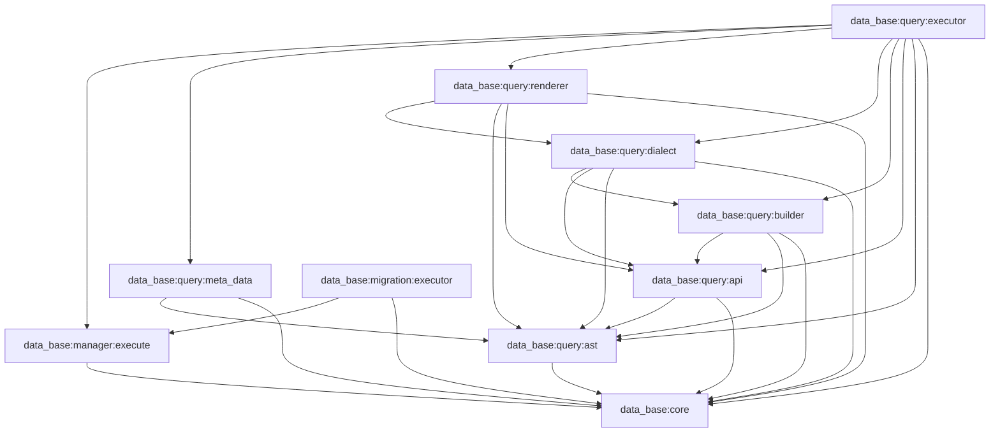

# Plan 14.0 — معماری هویت پارامتر و اجرای QueryBuilder

## وضعیت

**وضعیت طراحی:** آمادهٔ بررسی و صدور مجوز اجرا  
**Implementation Authorization:** صادر نشده  
**دامنهٔ این سند:** بررسی Repository، تصمیم‌های معماری و معیارهای پذیرش؛ بدون تغییر کد.

Plan 14.0 مبنای مستقل طراحی این کار است. Planهای 13 و 13.1 فقط سابقه و شواهد تغییرات قبلی‌اند و نباید به‌صورت مرحله‌ای ادامه داده شوند. این تصمیم مجوز حذف یا بازنویسی فایل‌های آن Planها یا تغییرات موجود working tree نیست.

## 1. هدف و مسئله

مسیر اجرای فعلی پارامترها را با نام placeholder در SQL تطبیق می‌دهد. در نتیجه، دو تعریف مستقل با نام منطقی یکسان نمی‌توانند مقدارهای متفاوت داشته باشند، حتی اگر در AST و Scopeهای مستقل قرار گرفته باشند. هدف این Plan، نگهداری تعریف پارامتر و هویت آن در ساختار Query، ثبت رخدادها بر اساس ترتیب SQL و Bind کردن JDBC بر اساس همان رخدادهاست.

نمونهٔ الزام‌آور برای مسیر نهایی:

- CTE یا Declaration داخلی: `shared_value = 11`
- Declaration والد: `shared_value = 22`
- Query مصرف‌کننده: `shared_value = 33`

هر سه مقدار باید مستقل بمانند؛ نام `shared_value` فقط نام منطقی/قابل‌مشاهده است و هویت binding را تعیین نمی‌کند.

## 2. شواهد Repository و محدودیت بررسی

این خلاصه بر source، Gradle و تست‌های موجود در working tree مورخ **2026-10-13** استوار است. در این مرحله Build و Test اجرا نشده‌اند. وضعیت Git هنگام تهیهٔ Plan روی شاخهٔ `main` نسبت به `origin/main` شامل **۱۶ فایل tracked تغییرکرده، ۶ فایل untracked و هیچ تغییر staged نبود**. منشأ هر تغییر از روی status به‌تنهایی قابل اثبات نیست؛ هیچ‌یک صرفاً به دلیل ارتباط ظاهری با Plan 13.1 قابل حذف یا نسبت‌دادن قطعی نیست.

### 2.1 ماژول‌ها و وابستگی‌های مستقیم

گراف زیر از `settings.gradle.kts` و `build.gradle.kts`های فعلی استخراج شده است. پیکان از مصرف‌کننده به وابستگی است.

| ماژول | وابستگی مستقیم مرتبط | مسئولیت مرتبط با پارامتر |
|---|---|---|
| `data_base:core` | ندارد | `SqlParameter`, `BuiltQuery`, تشخیص نوع SQL و `bind(PreparedStatement, index)` |
| `data_base:query:ast` | `core` | قراردادها و nodeهای AST؛ اکنون چند فیلد مقدار را به‌صورت `Any?`, `MutableList<Any>` یا نام/tag متنی نگه می‌دارند |
| `data_base:query:api` | `core`, `query:ast` | APIهای Builder و `IQueryApi.params` |
| `data_base:query:builder` | `core`, `query:ast`, `query:api` | ایجاد پارامترها، ثبت آن‌ها در AST و فهرست‌های Builder |
| `data_base:query:dialect` | `core`, `query:ast`, `query:api`, `query:builder` | `ISqlDialect`, render context/registry و dispatcher پایه |
| `data_base:query:renderer` | `core`, `query:api`, `query:ast`, `query:dialect` | تولید SQL clause به clause؛ شامل MySQL و MariaDB |
| `data_base:query:executor` | `tools`, `core`, `query:ast`, `query:builder`, `query:api`, `query:dialect`, `query:renderer`, `manager:execute` | اتصال Builder، Renderer و اجرای Query |
| `data_base:query:example` | `tools`, `core`, `models:eloquent`, `manager:execute`, `query:api`, `query:ast`, `query:builder`, `query:renderer`, `query:executor` | نمونه‌های DSL و regressionهای مثال |
| `data_base:manager:execute` | `manager:connection`, `core` | تبدیل SQL به JDBC statement و Bind کردن `SqlParameter` |
| `data_base:migration:builder` | `core`, `migration:params`, `migration:ast`, `migration:api` | Builderهای Migration و فهرست پارامترهای legacy |
| `data_base:migration:executor` | ماژول‌های Migration، چند ماژول Query و `manager:execute` | اجرای Migration از مسیر جداگانهٔ `BuiltQuery`/`IQueryExecute` |

`settings.gradle.kts` ماژول `data_base:query:meta_data` را ثبت نمی‌کند. `plans/meta_data/vision.md` یک سند چشم‌انداز است و وجود آن به معنی وجود ماژول اجرایی نیست.

وابستگی `query:dialect → query:builder` در Gradle وجود دارد؛ جست‌وجوی source در این ممیزی مصرف مستقیم آن را روشن نکرد. در Plan اجرایی حذف یا جابه‌جایی این edge مجاز نیست مگر اینکه مصرف واقعی و امکان کامپایل جداگانه بررسی شود.

### 2.2 مسیر فعلی پارامتر

```text
sideValue(name, value) / addParam(value) / insert-column / update-column
       │
       ├── SqlParameter.of(name, value)  (یا nullOf(name, sqlType))
       ├── AST: متن نام‌دار یا SqlParameter reference در نسخهٔ جاری working tree
       └── IQueryApi.params: MutableList<SqlParameter<*>>
                 │
                 ├── dialect.render(ast) -> SQL نام‌دار مانند :shared_value
                 └── QueryBuilderExecutor.executeOut -> BuiltQuery(sql, params)
                          │
                          └── BuiltQuery.getListParamNames()
                              -> IQueryExecute.readyParamsInQuery()
                              -> تطبیق بر اساس name
                              -> SqlParameter.bind(ps, index)
```

شواهد و مسیرها:

- `data_base/core/src/main/kotlin/query/reader/SqlParamData.kt`: `SqlParameter<T>` یک `data class` با `name`, `value`, `sqlType` است. `of` نوع SQL را resolve می‌کند، `nullOf` نوع null را صریح می‌گیرد و `bind` از `setNull` یا `setObject` استفاده می‌کند. فیلد `id` وجود ندارد.
- `data_base/core/src/main/kotlin/query/reader/BuiltQuery.kt`: `getListParamNames()` placeholderهای `:name` را از SQL به ترتیب متنی استخراج می‌کند، پارامترهای هم‌نام را از نظر value و sqlType اعتبارسنجی می‌کند و پارامتر اضافه/گمشده را رد می‌کند؛ `getReadyQuery()` placeholderها را به `?` تبدیل می‌کند.
- `data_base/query/api/src/main/kotlin/interfaces/api/IQueryApi.kt`: قرارداد عمومی `ast` و `params: MutableList<SqlParameter<*>>` را ارائه می‌کند.
- `data_base/query/builder/src/main/kotlin/ast/select_builder/conditions_item/QueryConditionsBuilder.kt`: `sideValue(name, value)` پارامتر scalar می‌سازد و به AST و `params` می‌دهد.
- `data_base/query/builder/src/main/kotlin/ast/select_builder/conditions_item_collection/QueryConditionsCollectionBuilder.kt`: collection نام‌های `${prefix}${index}` را به AST و فهرست Builder می‌دهد.
- `data_base/query/builder/src/main/kotlin/ast/insert_builder/column_insert/QueryColumnInsertBuilder.kt` و `data_base/query/builder/src/main/kotlin/ast/update_builder/column_update/QueryColumnUpdateBuilder.kt`: پارامترها در فهرست نگه‌داری می‌شوند؛ AST فعلی `columnTag` متنی دارد.
- `data_base/query/executor/src/main/kotlin/interfaces/IQueryBuilderExecutor.kt`: `executeOut` با `dialect.render(ast)` و `queryBuilder.params` یک `BuiltQuery` می‌سازد؛ `paramsMap` برای callback با `associate { name to value }` تولید می‌شود و برای نام‌های تکراری lossy است.
- `data_base/manager/execute/src/main/kotlin/interfaces/IQueryExecute.kt`: `execute(BuiltQuery)` ابتدا query و نام occurrenceها را آماده و mismatchها را پیش از بازکردن connection اعتبارسنجی می‌کند؛ `readyParamsInQuery` پارامترها را با نام resolve می‌کند.
- `data_base/manager/execute/src/main/kotlin/manager/QueryExecute.kt`: هر occurrence نامی به index JDBC مربوطه Bind می‌شود. این مسیر ترتیب occurrenceهای SQL را حفظ می‌کند، اما دو تعریف هم‌نام با مقادیر متفاوت را نمی‌تواند resolve کند.

### 2.3 AST، Builder و ترتیب SQL

- `IQueryRenderSelectAst` در `data_base/query/ast/src/main/kotlin/interfaces/select_interface/query_render_select/IQueryRenderSelectAst.kt` ساختار `withs`, `select`, `table`, `joins`, `where`, `group`, `order`, `limit`, `offset` را نگه می‌دارد.
- `IQueryConditionsAst.conditionSideRight` در `.../conditions_item/IQueryConditionsAst.kt` از نوع `Any?` است؛ `IQueryConditionsCollectionAst.paramsCollection` در `.../conditions_item_collection/IQueryConditionsCollectionAst.kt` از نوع `MutableList<Any>` است.
- `IQueryColumnInsertAst` و `IQueryColumnUpdateAst` در مسیرهای `interfaces/insert_interface/column_insert/` و `interfaces/update_interface/column_update/` فقط `columnTag: String?` را برای placeholder دارند.
- `QueryRenderSelectBuilder` clauseها را در فیلدهای مستقل AST ثبت می‌کند؛ بنابراین ترتیب فراخوانی `where`, `from`, `joins` به‌تنهایی ترتیب SQL را تعیین نمی‌کند.
- `MySqlQueryCapability.render` ترتیب متنی render را تعیین می‌کند: `WITH`, `SELECT`, `FROM`, `JOIN`, `WHERE`, `GROUP`, `ORDER`, `LIMIT`, `OFFSET`.
- `MySqlQueryConditionCapability` و `MySqlQueryConditionCollectionCapability` پارامترهای condition را به SQL نام‌دار تبدیل می‌کنند. در working tree جاری، occurrence collector در صورت فعال بودن از همین render مسیر ثبت می‌شود و scalar شرط نامعتبر پیش از ثبت rollback می‌شود.
- `MySqlQueryTableCapability` بازگشتی به `derivedQuery` دارد؛ CTEهای تو‌در‌تو و queryهای مشتق‌شده بخشی از render بازگشتی‌اند.

### 2.4 Dialectها و تست‌ها

- `data_base/query/renderer/src/main/kotlin/dialects/MySqlDialect.kt` ثبت rendererهای SELECT و mutation را انجام می‌دهد. `MariaDbDialect` از `MySqlDialect` ارث می‌برد. `DialectQuery` فعلاً MySQL و MariaDB را معرفی می‌کند؛ SQLite comment شده است.
- قرارداد `ISqlDialect.render(ast): String?` در `query:dialect` فقط رشته برمی‌گرداند. `BaseSqlDialect.renderWithBindings` که اکنون در working tree دیده می‌شود، خروجی `Pair<String?, List<Any>>` دارد و در `ISqlDialect` نیست؛ مصرف‌کننده‌ای که فقط `ISqlDialect` می‌بیند این قابلیت را تضمین‌شده ندارد.
- تست‌های موجود: `data_base/core/src/test/kotlin/query/reader/BuiltQueryTest.kt`, `data_base/manager/execute/src/test/kotlin/manager/QueryExecuteContractTest.kt`, `data_base/query/builder/src/test/kotlin/ast/select_builder/InlineCteParameterBindingTest.kt`, `QueryRelationContractTest.kt`, `QueryDeclarationTest.kt`, `QueryMetadataResolutionTest.kt`, `TypedRelationPropertyTest.kt`, `QueryRelationMySqlIntegrationTest.kt` و `data_base/query/executor/src/test/kotlin/manager/QueryConsumerTest.kt`, `SmartQueryResultTest.kt`.
- تست‌های `ParameterBindingScopeTest` و `ParameterIdentityPhaseOneTest` نیز در working tree حاضرند، اما untracked بودن آن‌ها و تغییرات دیگر به‌تنهایی منشأ یا مالک تغییر را ثابت نمی‌کند. در Plan اجرایی این تست‌ها باید بازبینی و در صورت سازگاری حفظ/تکمیل شوند، نه حذف خودکار.

## 3. تصمیم‌های معماری هدف

### 3.1 تعریف و هویت

1. در مرحلهٔ اول **نوع فعلی `SqlParameter` حفظ می‌شود**؛ constructor عمومی، `of`, `nullOf`, `data class`، `copy`, component functions، equality و `bind` بازطراحی نمی‌شوند.
2. یک نمونهٔ `SqlParameter` تعریف binding است و **reference identity همان نمونه** هویت فنی آن در طول Query است. هیچ `id` رشته‌ای، random ID، global allocator یا مقایسهٔ name/value/sqlType برای تعیین هویت اضافه نمی‌شود.
3. `SqlParameter` همچنان `name`، `value` و `sqlType` را نگه می‌دارد. نام برای SQL قابل‌مشاهده، log و diagnostics است؛ مقدار و SQL type برای JDBC.
4. دو نمونهٔ جدا، حتی اگر `name`, `value`, `sqlType` و `equals()` یکسان باشند، دو تعریف مستقل‌اند. تمام index، set و map داخلی برای هویت باید از reference identity، مانند `IdentityHashMap`/`===` استفاده کنند، نه equality/hashCode داده‌ای.
5. چند محل AST که **همان شیء** `SqlParameter` را نگه می‌دارند، عمداً یک تعریف مشترک را استفاده می‌کنند. هر محل renderشده همچنان یک occurrence جدا و یک JDBC index دارد.
6. `copy()` یک شیء دیگر می‌سازد و بنابراین تعریف مستقل است، حتی اگر از نظر `data class` برابر باشد. این رفتار باید صریحاً مستند و تست شود.

### 3.2 نقطهٔ ایجاد و API مصرف‌کننده

- امضای موجود `sideValue(name, value)` حفظ می‌شود. هر فراخوانی یک `SqlParameter.of(...)` تازه می‌سازد و تعریف مستقل ایجاد می‌کند؛ برابری name/value به معنی reuse نیست. این semantics با مسیر پایهٔ فعلی `HEAD` نیز سازگار است: پیش از diff فعلی، builder هر بار یک `SqlParameter` تازه به list اضافه می‌کرد.
- reuse باید صریح باشد: مصرف‌کننده یک handle موجود `SqlParameter` را به API ارجاع‌دهنده می‌دهد. Plan اجرایی overload/entry pointهای محدود و بدون ابهام را اضافه می‌کند: `sideValue(parameter)` برای scalar، `addParameter(parameter)` برای collection و `columnParameter(...)` برای مقدارهای INSERT/UPDATE (شامل variantهای رشته‌ای و Model-backed موجود). `SqlParameter.of(name, value)` و `nullOf(name, sqlType)` محل ساخت handle باقی می‌مانند؛ API هیچ id دریافت نمی‌کند.
- APIهای قدیمی `sideValue(name, value)`, `sideValueCollection(name, ...)`, `column(..., value)` تغییر نمی‌کنند. هیچ `parameters {}` شاخهٔ عمومی جدید اضافه نمی‌شود.
- افزودن member به interfaceهای public می‌تواند بر implementerهای بیرونی اثر source/binary داشته باشد. قبل از API change تمام implementerهای داخل مخزن جست‌وجو می‌شوند؛ امضاهای فعلی باقی می‌مانند و API جدید additive خواهد بود. تضمین binary compatibility بدون artifact/versioning baseline داده نمی‌شود. اگر default method معتبر و قابل‌تأیید در قرارداد Kotlin/JVM مخزن نباشد، entry point extension/capability محدود بررسی و تصمیم در diff ثبت می‌شود؛ interface موازی عمومی بدون نیاز ساخته نمی‌شود.

### 3.3 AST و منبع حقیقت

- هر مقدار پارامتری‌شده باید یک ارجاع مستقیم و قابل‌ردیابی به همان نمونهٔ تعریف در AST داشته باشد؛ ساخت هویت از placeholder، string name یا مقدار ممنوع است.
- scalar condition در `conditionSideRight` همان `SqlParameter` reference را نگه می‌دارد؛ این فیلد `Any?` در فاز نخست حفظ می‌شود تا expressionهای غیرپارامتری و compatibility موجود شکسته نشوند، ولی Builder و metadata visitor فقط انواع شناخته‌شده را می‌پذیرند.
- collection AST به `MutableList<SqlParameter<*>>` یا قرارداد نوع‌دار معادل مهاجرت می‌کند تا هر occurrence مرجع تعریف را نگه دارد.
- INSERT/UPDATE AST فیلد typed `SqlParameter<*>?` می‌گیرد؛ `columnTag` برای SQL/API قدیمی باقی می‌ماند و renderer در صورت نبود reference از مسیر قدیمی استفاده می‌کند. Builderهای string و Model مقدار را هم در typed field و هم در `params` compatibility list ثبت می‌کنند.
- SELECT/CTE/derived query/Join/Where/collection/`WITH` recursive childها همان referenceها را حفظ می‌کنند؛ کپی AST مجاز است فقط اگر ارجاع را به همان `SqlParameter`ها وصل نگه دارد.
- `IQueryApi.params` و flat params Builder تا پایان مهاجرت حفظ می‌شود، اما مسیر جدید آن را منبع حقیقت binding نمی‌داند. در parallel phase این list فقط compatibility projection/legacy path و منبع مقایسه برای regression است.
- تعریف بلااستفاده به‌صورت registry جداگانه وجود ندارد: هر تعریف با ساخته‌شدن مستقیم در AST مصرف‌کننده ثبت می‌شود. اگر reference در AST هست اما renderer آن را به SQL نمی‌رساند، در metadata-vs-occurrences اعتبارسنجی «تعریف استفاده‌نشده» تشخیص داده می‌شود. اگر renderer occurrence ثبت کند که visitor در AST نیافته، خطای reference نامعتبر است.

### 3.4 ماژول `query:meta_data`

**تصمیم: ایجاد ماژول مستقل `data_base:query:meta_data` لازم است**؛ مسئولیت آن محدود به استخراج metadata اجرایی از Query AST است، نه metadata عمومی Model/column.

دلیل: استخراج پارامتر باید یک traversal خالص و قابل‌آزمون از درخت باشد که از Builder، Dialect، Renderer، Executor و JDBC مستقل بماند؛ مخلوط‌کردن آن با execution coordinator مسئولیت مستقل را پنهان می‌کند. وجود یک مصرف‌کنندهٔ اولیه (query executor) به‌تنهایی مانع این مرز نیست، زیرا قرارداد extraction جزء صریح طراحی Plan 14 است. ماژول نباید برای انتقال `QueryBuilderMetadata` یا reflection مربوط به Model استفاده شود.

قرارداد موردنظر:

```text
QueryParameterMetadataExtractor.extract(ast: IQueryAst)
    -> QueryParameterMetadata

QueryParameterMetadata:
    definitionsByIdentity: identity-keyed collection<SqlParameter<*>>
    validateOccurrences(occurrences: List<SqlParameter<*>>)
```

جزئیات API نام‌گذاری در implementation مطابق convention واقعی تعیین می‌شود؛ semantics بالا قطعی است. Visitor باید با نوع‌های AST شناخته‌شده و recursion صریح کار کند، نه reflection روی نام فیلدها. یک identity می‌تواند occurrenceهای متعدد داشته باشد. AST reference ناشناخته، parameter AST با placeholder بدون definition، و definition بدون occurrence پس از render باید با خطای قابل‌تشخیص رد شوند. هیچ definition از SQL text استخراج نمی‌شود.

وابستگی‌ها:

```text
data_base:query:meta_data -> data_base:core
data_base:query:meta_data -> data_base:query:ast
data_base:query:executor -> data_base:query:meta_data
```

`query:meta_data` به `query:api`, `query:builder`, `query:dialect`, `query:renderer`, `query:executor`, `manager:execute` یا Migration وابسته نمی‌شود. `manager:execute` نیز به `query:meta_data` وابسته نخواهد شد.

### 3.5 Renderer و occurrenceها

- ترتیب binding فقط از traversal نهایی Renderer حاصل می‌شود، نه از ترتیب فراخوانی Builder یا ترتیب `params`.
- قرارداد رندر جدید یک نتیجهٔ typed مانند `RenderedQuery(sql, parameterOccurrences)` می‌دهد. فهرست occurrenceها به ترتیب placeholderهای SQL است و هر entry reference دقیق به `SqlParameter` definition دارد.
- scalar condition فقط وقتی وارد occurrence list می‌شود که condition واقعاً در SQL خروجی باشد؛ collection هر placeholder را در جای تولیدش ثبت می‌کند. رندر بازگشتی WITH/CTE/derived source/JOIN نیز همان render session را به‌کار می‌برد.
- dialect موجود `ISqlDialect.render(ast): String?` برای compatibility باقی می‌ماند. قابلیت occurrence-aware اختیاری و typed در مرز `query:dialect` تعریف می‌شود؛ `BaseSqlDialect` و built-in MySQL/MariaDB آن را پیاده می‌کنند. هر `ISqlDialect` مستقیم/custom که این قابلیت را پیاده نکند فقط در مسیر legacy collision-free قابل‌استفاده است؛ identity-aware execution برای آن باید fail-fast کند، نه اینکه binding را از نام حدس بزند.
- SQL log/display همچنان از نام منطقی مانند `:shared_value` استفاده می‌کند. وقوع‌ها تکرار نام را مجاز می‌کنند. تبدیل به JDBC syntax به‌ترتیب و با اعتبارسنجی تعداد placeholder/occurrence انجام می‌شود؛ نام SQL هیچ نقشی در resolve هویت ندارد.
- `IRenderContext` فعلی و `RenderSessionRegistry` در working tree وضعیت موقت دارند. typed کردن occurrenceها و انتقال قرارداد به result واقعی لازم است؛ sidecar untyped `MutableList<Any>` را نمی‌توان قرارداد نهایی دانست.

### 3.6 Executor و JDBC

- مسیر identity-aware بعد از استخراج metadata و rendering، یک transport خنثی از Query AST به `data_base:core` می‌دهد:

  ```kotlin
  BoundQuery(sql: String, parametersInOccurrenceOrder: List<SqlParameter<*>>)
  ```

  `BoundQuery` occurrenceها را فهرست می‌کند، نه unique definitions؛ یک reference مشترک ممکن است چند بار در list بیاید.
- `manager:execute` overloadهای ordered برای SELECT/INSERT/UPDATE/DELETE را پیاده می‌کند و هر `parametersInOccurrenceOrder[i]` را مستقیماً به JDBC index `i + 1` می‌بندد. اعتبارسنجی placeholder-count و binding-count پیش از بازکردن connection انجام می‌شود. این مسیر به query AST یا metadata وابسته نیست.
- مسیر فعلی `BuiltQuery(sql, params)` و `IQueryExecute` نام‌محور بدون تغییر برای مصرف‌کننده‌های legacy باقی می‌ماند. `BuiltQuery` constructor و `getListParamNames()` حذف یا تغییر قرارداد نمی‌شوند.
- `QueryBuilderExecutor` اجرای identity-aware را برای queryهایی که AST آن‌ها identity reference دارد انتخاب می‌کند. queryهای دستی/legacy فاقد referenceهای AST از مسیر `BuiltQuery` استفاده می‌کنند. query مخلوط/ناسازگار باید خطای روشن بدهد، نه fallback خاموش که duplicate binding را اشتباه resolve کند.
- ساخت SQL JDBC باید placeholderها را با همان dialect syntax تبدیل کند و تعدادشان را با occurrences تطبیق دهد. در صورت نیاز به lexer برای جلوگیری از تفسیر colon داخل literal/comment به‌عنوان placeholder، این lexer در مرز تبدیل SQL تعریف و با fixtureهای واقعی تست می‌شود؛ `BuiltQuery` regex legacy برای مسیر جدید، بدون این بررسی، کپی نشود.

### 3.7 رفتارهای سازگاری دیگر

- `QueryConsumer.sql()` و `MutationQueryConsumers.sql()` اکنون `BuiltQuery` می‌سازند؛ این خروجی برای دو binding مستقل هم‌نام و متفاوت نمی‌تواند semantics را نمایش دهد. امضای فعلی حفظ می‌شود و همچنان مسیر legacy/diagnostic است؛ همان محدودیت تعارض نام را صریحاً حفظ/گزارش می‌کند. اجرای عادی QueryConsumer از مسیر جدید استفاده می‌کند.
- callback موجود `blockQueryInfo(query, paramsMap)` از `Map<String, Any?>` استفاده می‌کند و `associate` نام تکراری را collapse می‌کند. امضا و رفتار compatibility آن حفظ و به‌عنوان view lossy مستند می‌شود؛ این map منبع binding نیست. افزودن API گزارش‌گیری چندمقداری در این Plan لازم نیست.
- `IQueryExecute.execute(BuiltQuery)` و `readyParamsInQuery` برای manual BuiltQuery تغییر نمی‌کنند. overload ordered جدید کنار آن اضافه می‌شود.
- Migration خارج از بازطراحی است: `migration:builder` و `migration:executor` فعلاً مدل flat و مسیر `BuiltQuery` را حفظ می‌کنند. `SqlParameter` در `core` تغییر نمی‌کند، `manager:execute` قرارداد legacy را نگه می‌دارد و Migration به `query:meta_data` وابسته نمی‌شود. تست‌های Migration فقط برای اثبات عدم regression اجرا می‌شوند.
- `SqlParameter` public data-class semantics حفظ می‌شود؛ Plan هیچ تضمین binary compatibility برای کل پروژه/مصرف‌کنندهٔ بیرونی نمی‌دهد، زیرا artifact/version policy و public ABI baseline در Repository پیدا نشده است.

## 4. گراف هدف ماژول‌ها



این نمودار، edgeهای فعلی را نشان می‌دهد و edgeهای جدید `meta_data`/ordered execution را اضافه می‌کند. Edge `query:dialect → query:builder` از وضعیت Gradle فعلی حفظ شده؛ حذفش تصمیم مستقل و خارج از Plan است. هیچ edge معکوسی از `core` یا `manager:execute` به Query ایجاد نمی‌شود.

## 5. دامنه و فایل‌های نامزد تغییر

فهرست زیر محدودهٔ پیاده‌سازی مورد انتظار است، نه گزارش تغییر انجام‌شده.

| ماژول | فایل‌ها/نمادهای نامزد | علت |
|---|---|---|
| `query:api` | `IQueryConditionsApi`, `IQueryConditionsCollectionApi`, `IQueryColumnInsertApi`, `IQueryColumnUpdateApi` | entry pointهای صریح reuse؛ امضاهای فعلی حفظ شوند |
| `query:ast` | `IQueryConditionsCollectionAst`, `QueryConditionsCollectionAst`, `IQueryColumnInsertAst`, `QueryColumnInsertAst`, `IQueryColumnUpdateAst`, `QueryColumnUpdateAst`; در صورت نیاز `IQueryAst` traversal support | typed parameter refs برای collection و INSERT/UPDATE |
| `query:builder` | `QueryConditionsBuilder`, `QueryConditionsCollectionBuilder`, `QueryColumnInsertBuilder`, `QueryColumnUpdateBuilder`, `QueryRenderSelectBuilder`, `QueryTableBuilder`, `QueryJoinsBuilder`, `QueryJoinsItemBuilder`, `QueryWhereBuilder`, `QueryWithsBuilder`, `QueryWithsItemBuilder`, `QueryRenderDeleteBuilder`; `ParameterBindingScope` | ایجاد/reuse تعریف‌ها، حفظ AST refs در nesting و flat compatibility list |
| `query:meta_data` (جدید) | `settings.gradle.kts`, `data_base/query/meta_data/build.gradle.kts`, visitor/metadata extractor و تست مستقل | استخراج identity definitions از Query AST |
| `query:dialect` | `ISqlDialect`-adjacent occurrence capability, `IRenderContext`, `RenderContext`, `RenderSessionRegistry`, `BaseSqlDialect` | نتیجهٔ typed render و انتقال occurrence order در render recursion |
| `query:renderer` | scalar/collection condition capabilities؛ insert/update render capabilities؛ query/table/with/join traversal و تست‌های Renderer | ثبت occurrence فقط برای placeholder واقعی با حفظ SQL output |
| `core` | `BoundQuery` کنار `BuiltQuery`; tests | transport positional ordered parameters بدون Query dependency؛ legacy `BuiltQuery` untouched |
| `manager:execute` | `IQueryExecute`, `QueryExecute`, تست‌های contract/JDBC | positional overload و binding index-order کنار مسیر name-based قدیمی |
| `query:executor` | `IQueryBuilderExecutor`, `QueryBuilderExecutor`, `QueryConsumer`, `MutationQueryConsumers` و تست‌ها | انتخاب مسیر identity-aware، حفظ `.sql()` و callback legacy |
| `query:example` | مثال‌های V1/V2/V3 فقط اگر امضای جدید reuse نیاز به نمونه دارد | مستندسازی call site و regression SQL |
| Migration | تغییر برنامه‌ریزی‌شده ندارد | حفظ قرارداد legacy؛ فقط regression test در صورت لزوم |

هر فایل از این فهرست در شروع فاز واقعی با `git status`/diff همان لحظه مقایسه می‌شود. تغییرات قبلی ادغام یا حذف نمی‌شوند؛ اگر روی همان خطوط تداخل دارند، ابتدا ثبت و حل می‌شوند.

## 6. Migration Plan و ترتیب کار

جزئیات اجرای مستقل در [Implementation Plan 14.0](v14.0-querybuilder-parameter-identity-implementation-plan.md) است. ترتیب وابستگی:

1. snapshot دقیق working tree و ثبت baseline SQL/errors/tests.
2. تثبیت semantics handle: هر `sideValue(name,value)` تعریف مستقل؛ reuse فقط با همان reference `SqlParameter`.
3. افزودن entry pointهای صریح reuse و typed AST fields برای تمام محل‌های پارامتردار QueryBuilder.
4. ساخت `query:meta_data` و identity-based extraction/validation.
5. تولید result typed Renderer با occurrenceهای مطابق placeholder order برای built-in dialectها.
6. افزودن `BoundQuery` و مسیر ordered JDBC کنار legacy BuiltQuery.
7. اتصال SELECT، CTE، derived query و سپس INSERT/UPDATE/DELETE به مسیر identity-aware.
8. مقایسه و regression across modules؛ سپس تبدیل مسیر جدید به پیش‌فرض.
9. تنها پس از تعیین تکلیف تمام مصرف‌کنندگان، حذف helperهای موقت Plan 13.1 که ثابت شده بلااستفاده‌اند؛ `BuiltQuery` و Migration path به‌دلیل نیاز compatibility خودکار حذف نمی‌شوند.

در هر مرحله شکست یا قرارداد ناشناخته‌ای که خارج از این Plan باشد، توقف و ثبت می‌شود؛ برای سبزکردن تست assertion ضعیف نمی‌شود.

## 7. آزمون‌های پذیرش

### 7.1 هویت و ایجاد/reuse

| آزمون | انتظار | محل اصلی |
|---|---|---|
| دو `SqlParameter` مستقل با نام یکسان، valueهای 11 و 22 | identity متفاوت؛ هر occurrence مقدار خودش را می‌گیرد | `query:builder`, `query:meta_data`, `manager:execute` |
| دو نمونه مستقل با name/value/sqlType یکسان | مستقل باقی می‌مانند؛ data-class equality هویت را یکی نمی‌کند | `query:meta_data` |
| یک reference واحد در دو scalar AST position | یک definition و دو occurrence؛ هر دو با همان value/type Bind می‌شوند | `query:builder`, `renderer`, `manager:execute` |
| یک reference واحد در scalar و collection یا JOIN/WHERE | reference مشترک حفظ و هر occurrence مرتب Bind می‌شود | `query:builder`, `renderer` |
| `SqlParameter.copy()` | کپی identity مستقل دارد | `query:meta_data` |
| `nullOf` با Types مختلف | مقدار null و SQL type هر تعریف حفظ می‌شود | `core`, `manager:execute` |

### 7.2 ساختار و ترتیب

1. سه سطح nested Declaration/CTE با `shared_value` و valueهای `11`, `22`, `33`؛ ترتیب occurrence SQL و JDBC دقیقاً متناظر باشد.
2. هر دو ترتیب ساخت clause بیرونی: `where → from` و `from → where`. SQL بر اساس renderer order و binding بر اساس occurrence list، نه call order.
3. scalar، collection `IN`, JOIN condition, CTEهای مستقل/تو‌در‌تو، inline CTE و `table { ... }`.
4. Query دارای پارامتر در explicit `WITH` body و dependency-first CTE render.
5. INSERT، UPDATE، DELETE؛ برای INSERT/UPDATE typed AST refs، برای DELETE Where condition path.
6. شرطی که render نمی‌شود: occurrence تولید نمی‌کند؛ تعریف باقی‌مانده در AST باید با سیاست unused-definition معتبرسازی شود (در این Plan رد می‌شود، مانند extra param مسیر legacy).
7. count mismatch: placeholder بدون occurrence یا occurrence بدون placeholder باید پیش از بازکردن connection شکست بخورد.
8. پارامتر اضافه از mutation/replacement دستی AST، پارامتر ناشناخته یا mixed legacy/new AST با خطای روشن رد شود.

### 7.3 سازگاری و integration

- SQL دقیقاً با نام‌های منطقی فعلی باقی بماند؛ مگر مورد جدیدی که خود API صریح reuse می‌دهد و نام را از handle می‌گیرد.
- `BuiltQuery.getListParamNames()` و conflict/missing/extra behavior روی manually-created BuiltQuery حفظ شود.
- `IQueryExecute` name path، `QueryConsumer.sql()`, mutation `.sql()`, `blockQueryInfo`, CRUD، Migration tests unchanged.
- custom dialect مستقیم و built-in MySQL/MariaDB. Dialect فاقد occurrence capability در حالت collision-free legacy کار کند و برای identity collision fail-fast کند.
- JDBC fake/PreparedStatement test اثبات کند هر occurrence به `setObject`/`setNull` با index/type/value موردانتظار رسیده است؛ حداقل یک MySQL integration test در محیطی با credential معتبر مکمل باشد. نبود دیتابیس، محدودیت گزارش‌شده است و با unit pass جایگزین ادعا نمی‌شود.

## 8. تصمیم‌ها و محدودیت‌های صریح

- **Migration:** خارج از دامنهٔ مهاجرت identity؛ قرارداد جداگانهٔ Migration حفظ می‌شود. استفاده از `SqlParameter` مشترک در `core` به معنی انتقال AST/Builder یا migration executor به مدل جدید نیست.
- **`params` و `blockQueryInfo`:** list و name-mapهای فعلی compatibility surface می‌مانند، اما identity execution از آن‌ها Binding استخراج نمی‌کند. map فعلی برای duplicate names inherently lossy است؛ این Plan signature آن را تغییر نمی‌دهد.
- **سازگاری بیرونی:** Repository artifact baseline، policy نسخه‌بندی و فهرست consumer بیرونی ارائه نمی‌کند؛ تضمین ABI داده نمی‌شود. امضاهای قدیمی حفظ می‌شوند و تست source compatibility داخلی لازم است.
- **custom dialect:** فقط MySQL/MariaDB selector رسمی فعلی‌اند. dialect مستقیم/custom تا زمان پیاده‌سازی capability، duplicate independent-name را پشتیبانی‌شده اعلام نمی‌کند.
- **raw SQL placeholder:** API عمومی ارائه‌شده از `SqlParameter` می‌سازد؛ AST دست‌ساز یا literal که `:name` را بدون parameter identity تزریق کند باید legacy path استفاده کند یا با خطا مواجه شود. پشتیبانی خودکار آن بدون تعریف binding identity ممنوع است.
- **شناسه:** id بیرونی/رشته‌ای تولید نمی‌شود؛ lifecycle identity همان reference `SqlParameter` داخل in-memory AST است. Serialization/deserialization AST در Repository مشاهده نشده و خارج از تضمین این Plan است.
- **تغییر زمان خطا:** Phase1 working-tree `ParameterBindingScope.canonical()` در زمان Builder بر اساس name و value/type تعارض می‌دهد؛ baseline `HEAD` هر `SqlParameter` را اضافه می‌کرد و تعارض را در validation مسیر BuiltQuery تشخیص می‌داد. Plan14 identity-aware queryهای هم‌نام متفاوت را مجاز می‌کند؛ legacy manual BuiltQuery همچنان conflict را پیش از اتصال JDBC رد می‌کند. زمان خطا و تفاوت دو مسیر باید با تست مستند شود.

## 9. معیار نهایی تکمیل

Plan14 زمانی از نظر پیاده‌سازی کامل است که:

1. AST برای هر مقدار پارامتری QueryBuilder مرجع مستقیم به definition هویت‌دار داشته باشد.
2. دو instance مستقل با هر نام/مقدار/type مستقل باقی بمانند و یک instance مشترک تنها با reuse صریح share شود.
3. metadata از AST استخراج شود و هیچ هویتی از نام یا SQL بازسازی نشود.
4. Renderer result SQL و occurrenceها را در یک render session و به ترتیب دقیق SQL بدهد؛ شرط omitted occurrence تولید نکند.
5. Executor/JDBC با occurrence order positional bind کند؛ duplicate logical names با values متفاوت موفق باشند.
6. legacy `BuiltQuery`, `IQueryExecute` name path، CRUD/Migration قراردادهای قبلی خود را حفظ کنند.
7. تمام tests گروه 7 عبور کنند؛ integration limitation صریح بماند.
8. مصرف‌کنندگان و dependencyها تعیین تکلیف شوند؛ حذف helperهای قدیمی فقط بر اساس evidence.

## 10. وضعیت اجرای این مأموریت

این فایل و Implementation Plan همراه آن تنها تغییرات مجاز این مأموریت هستند. هیچ سورس، تست، Gradle، README، Plan 13/13.1، Stage یا Commit در این مرحله تغییر نمی‌کند. Implementation بعدی به مجوز جداگانه نیاز دارد.
